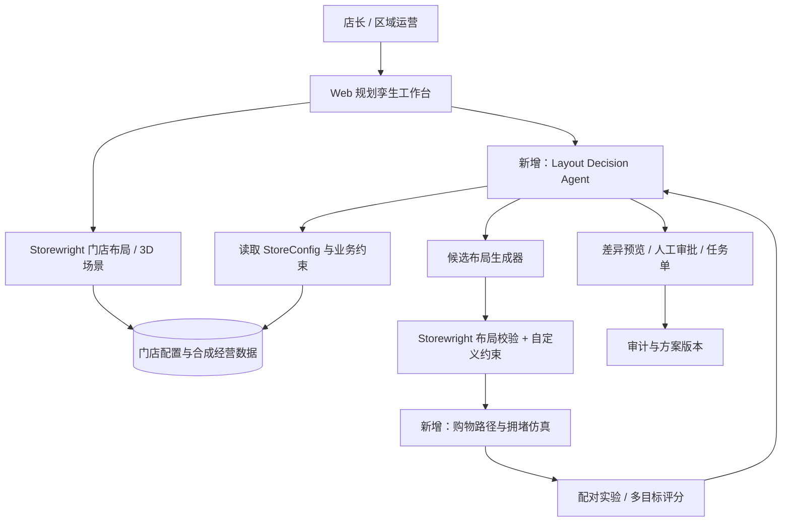
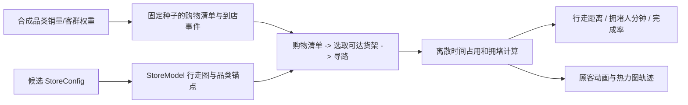
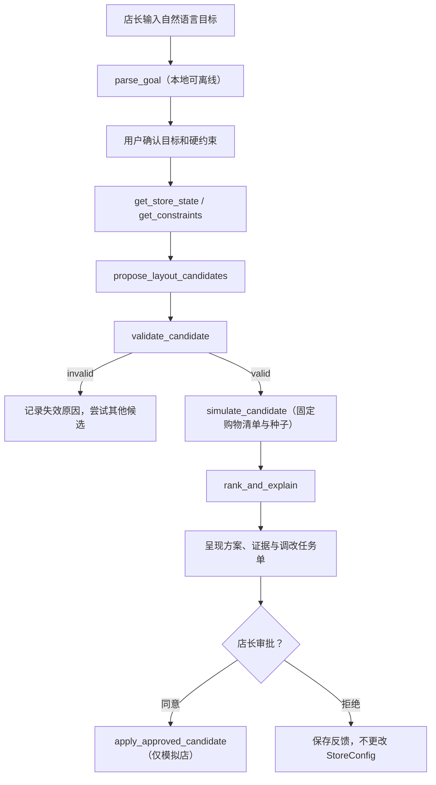
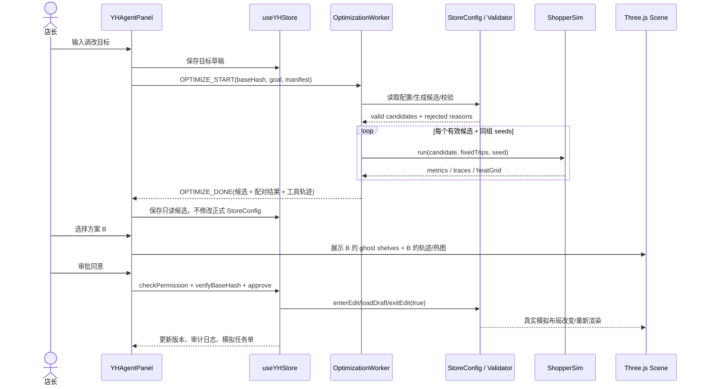

# SPEC — YH TwinOps：基于 Storewright 的永辉超市生鲜区布局调改数字孪生 Agent

> **版本**：2.0（Three.js 场景 + Agent 工程实施版；包含 1.0 业务/架构基线）  
> **状态**：Implementation-ready Specification（开发前仍需先完成 Sprint 0 基线验证）  
> **日期**：2026-11-14  
> **目标课程**：《企业架构与数字化转型》期末大作业  
> **基础仓库**：[Glacieerr/storewright](https://github.com/Glacieerr/storewright)  
> **审阅基线**：`main` @ [`1554726c7d084b75eca33fc5f99660e3749ad475`](https://github.com/Glacieerr/storewright/commit/1554726c7d084b75eca33fc5f99660e3749ad475)（2026-11-10）  
> **项目性质**：教学与研究原型；不代表永辉官方系统、不连接企业生产数据。  
> **优先级**：P0 = 课程必做；P1 = 时间允许；P2 = 未来企业化路线。
> **阅读导航**：第 0–15 节是课程需求、EA 与 MVP 的完整基线，第 **16–29 节**是新增的 **Three.js 实景建模、程序化生成、接口契约、Agent 运行机制、仿真建模、测试与 Codex 开发手册**。请按顺序实施，不能跳过验证直接生成整个项目。

---

## 0. 决策摘要（必须先读）

**项目正式题目**：**《面向永辉超市生鲜区调改的数字孪生智能体开发与企业数字化转型落地方案——基于 Storewright 的二次开发》**。

**唯一核心业务决策**：在生鲜区调改之前，店长/区域运营人员希望在不突破通道、货架数量和改造成本约束的情况下，比较不同货架位置与品类陈列方案，减少模拟顾客行走距离及局部拥堵，生成可审阅的调改任务单。

**产品主循环**：选择试点门店与基线布局 → 输入改造目标 → Agent 读取布局和约束 → 自动生成候选布局 → 校验约束 → 在相同随机种子下仿真顾客路径 → 比较指标 → Agent 推荐并解释 → 店长批准/拒绝 → 将**批准版本**提交至模拟沙盒、记录日志。

**严格的范围约束**：

1. **P0 仅做一家模拟永辉门店的一个生鲜区**（示例：约 28 m × 20 m 的可编辑试点区、6–8 条通道、4 类商品；具体尺寸以通过上游 StoreConfig 校验的配置为准；这些数值仅为教学数据参数）。
2. **只优化货架通道位置、方向和品类分配**；不实现完整 POS、真实营收预测、真实门店联网、无人采购、排班、供应链运输、复杂多楼层动线。
3. P0 用**两份来源不同的合成数据**（模拟门店布局/品类映射 + 模拟 POS 品类销售统计）建立统一 `category_id`，支撑目标顾客购物清单生成；重用 Storewright 已有的场景编辑、StoreConfig、布局校验、2D/3D 渲染、Web Worker 和策略比较框架；**新增的原创贡献**是自然语言调改目标解析、约束驱动的布局方案生成、与布局因果关联的顾客行为仿真、目标函数、多方案证据比较、人工审批与门店调改工作单。
4. 必须对外展示“**使用合成数据的规划数字孪生**”；无真实门店数据时，不能称作“已上线的永辉实时数字孪生”，也不得宣称真实销售提升。
5. **采用单 Agent + 工具链**，不是为了技术噱头使用多智能体。Agent 必须有可观察、可复现的调用轨迹，而不是一次 LLM 自由生成的答案。

---

## 1. 作业要求与产品追踪矩阵

来源：用户提供的《企业架构与数字化转型期末大作业》3 页 PDF。所有产物缺一不可。

| 课程阶段 | 分值 | 必须提交 | YH TwinOps 对应交付 | 验收 |
|---|---:|---|---|---|
| 阶段 1：企业场景调研 | 15 | 3 人分工；约 1500 字调研报告 | 永辉公开资料、门店调改流程 AS-IS、痛点证据、TO-BE、价值假设与来源表 | 每条企业现状结论可溯源，假设与事实分开 |
| 阶段 2：架构 + MVP | 30 | EA 架构；原型图；3–5 分钟演示视频 | 业务/数据/应用/技术四层架构；可运行的 Storewright 扩展；演示录像 | 非静态效果：真实执行工具调用、布局校验和至少 3 方案仿真 |
| 阶段 3：落地方案 | 35 | 3000–5000 字报告 | 现状需求、架构适配、数据集成、系统集成、组织适配、分阶段推广、风险与 KPI | 含落地实施约束、成本/收益评估框架、故障回退 |
| 阶段 4：成果展示 | 20 | 15–20 分钟 PPT 答辩 | 约 12–14 页 PPT + Demo + 团队分工与收获 | 三人均能说明 EA、数据、Agent 和价值 |

**加分策略**：提出“门店布局数字孪生 + Agent 约束优化 + 仿真审批”的 EA 扩展；用统一布局/品类/客流数据驱动协同；提供门店调改试点与回退机制。  
**重点避险**：不能伪造永辉现有系统或访谈；不能直接照搬上游 Storewright 的架构、报告或 UI 当原创；演示必须稳定；必须明确三人职责。

---

## 2. 企业背景、调研事实与业务假设

### 2.1 已有公开事实（用于背景，不等于系统接入权限）

永辉超市 2026 年第三季度报告披露：截至 2026-09-30 已开业 **383** 家门店、累计调改开业门店 **338** 家；前三季度营业收入 **352.42 亿元**，公司指出调改运营进入提质增效第二阶段。这支持研究“门店调改方案如何降成本、提高运营效率”，**不证明**永辉现有门店缺少 AI、动线存在严重拥堵、或任何特定系统接口可供接入。

- [永辉 2026 年第三季度报告（官方 PDF）](https://www.yonghui.com.cn/upload/financial/12685173.PDF)
- [上海证券报披露文本](https://paper.cnstock.com/html/2026-10/31/content_2285634.htm)

### 2.2 待调查/验证的工作假设

- H1：生鲜区部分高频类别布局可能造成重复绕行。
- H2：实体货架/品类调整的现场试错存在工作量和营业干扰成本。
- H3：调改参与者希望提前看到可比较、可解释和可复核的方案，而非单一“最优”结果。

这些属于课程设计假设。要求至少形成**公开资料证据表**；若可获得访谈/实地观察，保存匿名访谈提纲、观察记录与授权情况；若无法获得内部资料，必须公开写“未验证实际问题与实际企业效益”。

### 2.3 业务流程（AS-IS / TO-BE）

- **AS-IS（行业流程假设，不能写成已确认的永辉内部事实）**：调改目标提出 → 门店人员盘点现状 → 人工制图或调整陈列方案 → 线下协调与评审 → 实施调改 → 根据运营反馈迭代。
- **TO-BE（本项目设计）**：调改目标提出 → 业务/布局数据归一 → Agent 自动生成多方案 → 规则校验 → 顾客行为仿真与多次实验 → 人机协同审定 → 生成任务单 → 实施与效果复盘。

### 2.4 用户、权限和业务价值

| 角色 | 需求 | 能做什么 | 不允许做什么 |
|---|---|---|---|
| 店长（Primary） | 快速比较候选方案 | 发起方案、调整目标、批准模拟调改 | 未授权直接改真实门店配置 |
| 区域运营人员 | 跨方案评价与复盘 | 查看指标与审计记录、反馈参数 | 越权修改采购/人员数据 |
| 门店陈列执行人员 | 了解改动清单 | 查看货架移动/品类调换任务 | 修改批准的方案内容 |
| IT/系统管理员 | 数据质量与治理 | 配置数据源、权限、模型版本 | 代替业务人员审批 |

**可测价值**：缩短调改方案形成时间；提供约束合规方案；降低模拟行走距离/拥堵指标；让修改过程可追溯。销售额、转化率增长不作为 P0 能力和结果承诺。

---

## 3. 上游 Storewright 技术基线（真实源码核对）

Storewright 是 TypeScript npm workspaces monorepo。根 `package.json` 要求 **Node.js >= 22**；规划孪生采用 React、Vite、Three.js/React Three Fiber、Zustand；仿真在 Web Worker 内运行。

| 源码位置（上游实际存在） | 已有能力 | 本次如何使用 |
|---|---|---|
| [`apps/simulator/src/scene/`](https://github.com/Glacieerr/storewright/tree/main/apps/simulator/src/scene) | 3D 门店、货架与顾客可视化 | 复用渲染，不重写 3D 引擎 |
| `apps/simulator/src/ui/EditorPanel.tsx` | 手动编辑通道/货架、导入导出 | 新增 Agent 候选方案预览入口 |
| `apps/simulator/src/state/store.ts`、`state/editOps.ts` | Zustand 状态、草稿、撤销/重做 | 通过已有编辑状态提交批准后的 patch |
| `apps/simulator/src/sim/worker.ts`、`sim/client.ts` | 全天模拟、AI 运营建议、策略对比 | 增加布局优化实验消息类型/独立 Worker |
| `packages/store-config/src/schema.ts`、`editing.ts`、`validate.ts`、`model.ts` | StoreConfig、`RunConfig`、布局编辑、校验、图寻路 `distance()` / `path()` | 复用配置协议、几何规则、行走图；添加新业务约束 |
| `packages/sim-engine/src/experiment.ts` | 公共随机数、重复实验、95% 区间、策略配对比较 | 复用实验思想，新增布局候选的客流指标 |
| `apps/simulator/src/ui/AiPanel.tsx` | AI 运营建议、采纳/忽略、可解释反馈 | 参考操作模式，不把原有建议系统当原创功能 |
| `apps/server/src/assistant/` | 本地门店助手、结构化只读工具 | P1 可集成 LLM 意图理解；P0 提供无 Key 规则解析降级 |
| `apps/simulator/src/scene/crowd.ts` | 顾客可视化轨迹 | **不能作为经营效果模拟**：源码明确写“只用于画面，不进入订单仿真” |
| `apps/simulator/src/yourStore/` | 门店创建、复制和浏览器导入导出 | 存储课程试点门店和候选布局 |

**关键差距**：已有编辑器能让人调整布局，已有 AI 建议偏向到货、后仓、暂存、前场等运营流程；它**不是**“店长输入调改目标后自动生成生鲜区布局方案并对客流路径做有效量化实验”的完成品。本项目独立补齐上述能力。

**启动并确认基线**：

```bash
git clone https://github.com/Glacieerr/storewright.git
cd storewright
git checkout 1554726c7d084b75eca33fc5f99660e3749ad475
node -v       # 22+
npm ci
npm run check
npm run dev      # 规划孪生，通常 http://localhost:5173
# 需要查看完整演示时：
npm run build:site
npm run demo:site
```

> 在实际 fork 中应创建工作分支，不要在上游仓库直接提交。若目标提交无法获取，则记录实际检出的 commit SHA 并重新审计接口。

### 3.1 开源复用与署名要求

- 上游**代码 AGPL-3.0**，文档/图片/示例资料主要为 **CC BY 4.0**；遵守版权声明、衍生/网络提供软件义务和署名要求。具体以仓库 LICENSE、LICENSE-docs、REUSE.toml 为准。
- Storewright 的**名称、图标不自动授权**；课程界面使用自定义 `YH TwinOps` 标识，永辉商标也不能伪装成官方合作产品。
- 报告设置“上游原有功能 / 我们新增功能 / 修改文件与提交记录”对照表；所有截图标注来源，不挪用已有模拟效果数字充当本组实验结果。

---

## 4. 产品规格：核心范围、用户故事与功能验收

### 4.1 P0 演示主路线

店长打开“永辉生鲜区规划孪生” → 查看基线 3D 布局和模拟客流 → 输入“请在不减少货架数、不缩窄通道的条件下，减少顾客平均行走距离与拥堵” → Agent 生成至少三个候选方案 → 逐一校验、仿真、评分 → 显示 A/B/C 与基线的指标和置信区间 → 预览货架变化 → 店长审批 → 生成模拟调改任务单和审计记录。

### 4.2 功能需求（带验收标准）

| ID | 优先级 | 功能 | 验收标准 |
|---|---|---|---|
| FR-01 | P0 | 试点门店加载与孪生视图 | 成功展示一个可旋转/缩放的门店、6–8 条通道、4 类商品，并能选中货架查看 `id`、品类 |
| FR-01A | P0 | 合成多源数据对齐 | 模拟 POS 品类销售 CSV + StoreConfig/陈列类别映射按 `category_id` 整合；不同来源、日期和单位可追踪；无匹配项给出数据质量错误 |
| FR-02 | P0 | 业务目标自然语言输入 | 支持 5 个固定中文命令模板；返回结构化 `OptimizationGoal`，展示解析出的目标/约束；未知输入明确提示补充或使用预设 |
| FR-03 | P0 | 自动生成候选布局 | 每次产生至少 3 个可区分方案，包括品类调整、平移/旋转货架等组合；不与基线完全相同 |
| FR-04 | P0 | 布局硬约束校验 | 每个候选必须通过 `validateStoreConfig` 和自定义业务约束；无效方案标注原因且不进入排名 |
| FR-05 | P0 | 顾客路径及拥堵仿真 | 购物清单驱动购物路线；商品品类变更会影响路径；输出距离、拥堵、完成率；固定 seed 可复现 |
| FR-06 | P0 | 同条件多方案实验 | 基线与候选共用 shopper profiles、购物清单与随机种子；显示均值、差值与波动范围，不混用不同输入 |
| FR-07 | P0 | Agent 解释与轨迹 | 可展示“读取→提案→校验→仿真→排序→推荐”的执行步骤、失败原因及评分构成 |
| FR-08 | P0 | 3D 方案差异预览 | 用户可切换基线/方案 A/B/C，并高亮移动或改类的通道；支持一键恢复基线 |
| FR-09 | P0 | 人工审批与任务单 | 只允许店长角色批准；批准前只动草稿；审批后生成变更清单及操作日志；拒绝和撤销有记录 |
| FR-10 | P0 | 结果导出 | 导出 JSON/CSV 结果和可用于报告的图表截图；包含 seed、假设、模型版本和数据标记 |
| FR-11 | P1 | 真实 CSV 数据适配 | 支持规范化导入销售量和品类映射、进行缺失值提示，但不强制真实接入 |
| FR-12 | P1 | LLM 自然语言解析 | 配置后以 schema-constrained 输出解析目标；失败回退规则解析，不允许 LLM 直接改 StoreConfig |
| FR-13 | P2 | 企业平台集成 | 与 ERP/POS/PIM、审批工作流、权限平台对接，所有写操作需授权与二次确认 |

### 4.3 明确不做的范围

- 真实销售收入、毛利提升预测；CV 摄像头客流识别；真实员工 GPS 定位。
- 整个永辉集团的实时数据汇聚；总部跨数百门店生产部署。
- 无限自主循环的 Agent；直接修改生产系统；无审核自动执行调改。
- 全部 SKU 的细粒度货位优化、物理人群动力学与消防专业评估。

---

## 5. 企业架构（Enterprise Architecture；按 TOGAF ADM 简化组织）

### 5.1 业务架构（Business）

| 业务能力 | 现状逻辑（待验证） | 目标业务能力 | 责任角色 |
|---|---|---|---|
| 调改需求管理 | 汇总目标，人工评审 | 可结构化目标与约束 | 店长、区域运营 |
| 门店布局规划 | 人工编辑/比对布局 | Agent 自动提出候选方案 | 区域运营、店长 |
| 客流影响评估 | 营业后观察调整 | 调改前的假设驱动模拟 | 运营分析人员 |
| 变更执行 | 下发陈列调整任务 | 审核→差异清单→执行→回执 | 店长、执行人员 |

**组织原则**：Agent 是“建议与试验者”，业务负责人是“批准者”；模型不持有直接变更生产系统的权限。输出 BPMN AS-IS/TO-BE + RACI 表。

### 5.2 数据架构（Data）

设计统一 `store_id`、`floor_id`、`run_id`、`category_id` 连接门店、楼层、货架、品类、场景与仿真；并引入版本化的布局草稿和审批历史。

**P0 两个数据入口**：① 既有 `StoreConfig` 的 `layout.runs[].categoryIds`（空间陈列来源）；② 新增 `category_sales_daily.csv`（`store_id, date, category_id, units_sold`，模拟 POS 来源）。`category_id` 统一编码并经过去重/缺失值校验，再生成购物清单类别权重。原始数据与生成的情景数据需分别保留来源标签，避免把合成购物行为描述为真实交易。

**新增逻辑实体**：

| 实体 | 主键/关键字段 | 用途 |
|---|---|---|
| `store_layout_revision` | revision_id, store_id, base_sha, config_json, status | 存储基线及候选布局快照 |
| `run_category_assignment` | revision_id, run_id, category_id | 标识品类在货架通道的分配 |
| `customer_profile` | profile_id, segment, speed_mps, visit_window | 合成顾客群组与速度假设 |
| `shopping_trip` | trip_id, seed, arrival_minute, categories_json | 按清单访问目标品类 |
| `layout_experiment` | experiment_id, base_revision, goal_json, seed_set, model_version | 保证可复现的实验输入 |
| `layout_experiment_result` | experiment_id, candidate_id, metrics_json, ci_json, validation | 记录结果及置信范围 |
| `approval_event` | approval_id, candidate_id, user_role, action, comment, at | 审批和审计 |
| `source_register` | source_id, source_type, reference_url, collected_at, reliability | 真实资料/合成数据来源登记 |

**P0 存储**：允许使用 Storewright 现有浏览器本地方案存储 + JSON 导出，降低开发风险。保留模拟 POS CSV 的校验与映射记录，展示两个来源如何合并为统一经营视图。  
**企业化演进**：后端 PostgreSQL + 对接企业主数据（商品/SKU）、POS、ERP、PIM、陈列图和客流数据；数据字典中记录粒度、时区、单位、权限、质量和刷新频率。**这些是假设的集成接口，不意味着已获永辉授权。**

### 5.3 应用架构（Application）



### 5.4 技术架构（Technology）

**P0 最大化重用 TypeScript 单体 monorepo**，不额外引入 Python 微服务，避免跨语言数据结构与部署复杂度。建议新增 `packages/layout-agent`（意图、候选方案、工具编排）及 `packages/shopper-sim`（顾客路径、拥堵仿真和实验评估），通过新 Web Worker 运行耗时仿真，UI 作为 `apps/simulator` 的一个新标签。

**P1 可选**：在 `apps/server/src/assistant/` 增加受控 LLM schema 解析工具；即使 API 不可用，也能完整播放教学 Demo。  
**P2**：统一身份认证、权限审计、独立数据服务、安全隔离、监控告警、缓存与后端持久化。

### 5.5 TOGAF 迁移思路

- Architecture Vision：把门店调改从一次性经验决策转为可回放、可审查的模拟决策。
- Business Architecture：定义业务能力、角色与审批权限。
- Data / Application / Technology Architectures：上述统一 ID、状态版本、应用模块和技术部署。
- Opportunities & Solutions：先运行浏览器合成数据规划孪生，再做授权数据接入。
- Migration Planning & Governance：单区试点、影子运行、验收达标后扩大范围；每次改动可审批、可回滚、可审计。

---

## 6. 新增软件模块与设计契约

### 6.1 推荐新增目录（仅为拟新增路径；**当前上游不存在**）

```text
packages/
  layout-agent/
    src/{goal.ts,tools.ts,proposal.ts,constraints.ts,orchestrator.ts,score.ts,index.ts}
    src/*.test.ts
  shopper-sim/
    src/{types.ts,profiles.ts,trips.ts,route.ts,congestion.ts,runner.ts,metrics.ts,index.ts}
    src/*.test.ts
apps/simulator/src/
  ui/{LayoutAgentPanel.tsx,LayoutComparePanel.tsx,LayoutDiffPanel.tsx}
  sim/{layoutWorker.ts,layoutClient.ts}
  state/layoutAgent.ts
  scene/LayoutHighlights.tsx
  i18n/en.ts               # 给新增中文文案补英文映射
public-or-docs/
  yonghui-demo-data/       # 合成数据/场景，按现有仓库结构安置
```

开发时应服从上游实际构建入口、workspace 命名和打包规范；路径仅是建议，不要求整个仓库重构。

### 6.2 数据类型（TypeScript 设计草案）

```ts
// 新增功能草案，非上游现有接口
export interface OptimizationGoal {
  storeId: string;
  targetAreaId: string;
  objectives: {
    meanWalkingDistance: number;  // 越小越好，权重
    p90CongestionDelay: number;
    completionRate: number;        // 越大越好，计算时取反
    changeCost: number;
  };
  constraints: {
    minPassageWidthM: number;      // 课程模拟参数，不声称符合当地消防规范
    maxMovedRuns: number;
    maxModificationCost: number;
    preserveEntrances: true;
    preserveRunCount: true;
  };
  shopperScenarioId: string;
  seedSet: number[];
}

export type LayoutPatch =
  | { op: 'MOVE_RUN'; runId: string; dxM: number; dyM: number }
  | { op: 'ROTATE_RUN'; runId: string }
  | { op: 'REASSIGN_CATEGORY'; runId: string; categoryIds: string[] };

export interface CandidateLayout {
  candidateId: string;
  baseRevisionId: string;
  patches: LayoutPatch[];
  validation: { valid: boolean; issues: string[] };
  label: string;
}

export interface CandidateMetrics {
  meanWalkingDistanceM: number;
  p90CongestionDelaySec: number;
  completedTripsRate: number;
  blockedOrUnreachableTrips: number;
  layoutChangeCost: number;       // 参数化的相对改造成本单位
}

export interface EvaluationResult {
  experimentId: string;
  candidateId: string;
  seeds: number[];
  metrics: CandidateMetrics;
  pairedDeltaVsBaseline: Record<string, { mean: number; ci95: [number, number] }>;
  assumptions: string[];
  modelVersion: string;
}
```

### 6.3 Agent 工具契约

| Tool | 输入 | 输出 | 关键安全要求 |
|---|---|---|---|
| `get_store_layout` | storeId, areaId | StoreConfig 子图/版本 | 只读 |
| `get_baseline_metrics` | scenarioId, seedSet | 基线指标 | 同实验配置缓存 |
| `propose_layouts` | goal, baseRevision | CandidateLayout[] | 只允许白名单 patch 类型 |
| `validate_candidate` | candidateId | valid, issues | 复用原有 validateStoreConfig，新增通道约束 |
| `simulate_shoppers` | candidateId, seedSet | per-seed metrics | 相同 seedSet，避免比较偏差 |
| `rank_candidates` | experimentId, weights | 综合评分 + Pareto 提示 | 仅对有效方案排序；分数可解释 |
| `preview_layout_diff` | candidateId | 3D 高亮差异 | 不写基线 |
| `request_approval` | candidateId, summary | pending decision | 不允许自我批准 |
| `apply_approved_layout` | approvalId | new revision / task list | 仅在有效批准后将 patch 应用于模拟项目 |

**执行状态机**：`IDLE → PARSING → PROPOSING → VALIDATING → SIMULATING → RANKING → AWAITING_APPROVAL → APPROVED/REJECTED → APPLIED`；所有异常转 `FAILED`，提供失败原因、重试/回退至基线。

**Agent loop 伪代码**：

```ts
const goal = parseIntent(userText) ?? choosePresetGoal();
const baseline = await simulateSameScenario(currentLayout, goal.seedSet);
const candidates = generateCandidates(currentLayout, goal, { maxCandidates: 8 });
const valid = candidates.filter(c => validate(c).valid);
const evaluated = await Promise.all(valid.map(c => simulateSameScenario(c, goal.seedSet)));
const ranked = rankByMultiObjective(evaluated, baseline, goal.objectives);
return makeApprovalRequest(ranked.slice(0, 3), baseline);  // 此处只返回建议
// 只有业务用户批准后才：applyToSandbox(approvedCandidate)
```

**候选生成策略（P0）**：以 3 种清晰可解释的启发式生成策略起步：① 高频品类靠近入口；② 将互补购物品类相邻布置；③ 限制移动货架数量并优化拥堵热点。可以在它们基础上进行不超过 8 轮有界的邻域搜索；**不可**直接让 LLM 自由输出未验证的坐标，也不可“无限循环搜索”。

### 6.4 顾客仿真模型（P0 新增的实质能力）

必须与原有“仅用于画面”的 shopper 轨迹明确区分：

1. 从可复现种子生成 N 名**合成顾客**：到达时刻、速度（示例 0.8–1.4 m/s）、购物品类清单、购物时间窗。
2. 将品类绑定到 `RunConfig.categoryIds`，由 `StoreModel` 建立真实可走路径。用其 `distance(a,b)` / `path(a,b)` 求可到达路径，遇到不可达目标时记录失败而不是忽略。
3. 走廊以每条边的长度、假定通行能力和当前占用建立简化排队/拥堵模型；顾客按时间步或离散事件推进，统计行走与拥堵延迟。
4. 相同顾客/购物清单/seed 对比基线和全部候选；模型随机源不得因布局不同而重新抽样顾客目标，否则结果不可比。
5. 输出至少：`meanWalkingDistanceM`、`p90CongestionDelaySec`、`completedTripsRate`、`unreachableTrips`、`layoutChangeCost`；不要从这几个变量推断真实客单价或销售增长。
6. 画面顾客可根据新增仿真轨迹更新，但**真实指标必须来自 shopper-sim，而非渲染帧率/动画随机运动**。

### 6.5 评分规则

各指标先统一方向并按基线或事先设定的业务尺度归一化；再使用可编辑权重（默认：平均距离 0.40、拥堵延迟 0.30、购物完成率 0.20、调改成本 0.10）求综合损失，**越低越好**。必须在 UI 明确解释“仅在当前模拟假设下排序”；有业务硬约束违规的候选一票否决。

**实验规范**：

- 开发 smoke：3 个候选 × 5 个固定 seed。
- 正式答辩：基线 + 3 个候选 × 20 个 seed（若性能不足，记录实际次数与限制）。
- 同随机数配对比较差值，输出均值与 95% 置信区间或分位范围；置信区间跨 0 不宣称确定改善。
- 保存完整 `seedSet`、模型版本、配置 hash、商品品类/顾客生成规则。
- 预先在报告列好数据表，**实际数值由运行后填写，不预设改善百分比**。

### 6.6 AI 解析与不可用回退

P0 使用基于有限模板、关键字和表单回退的**确定性意图解析器**，确保无网络、无 API Key、无 LLM 时演示仍完整。P1 可增加强制 JSON Schema 的 LLM 调用，只能调用白名单工具；输出需要结构校验、数值上下界、操作审批。UI 必须区分“模板规则生成/LLM 解析”避免夸大 AI 水平。

---

## 7. 产品页面与交互验收

### 7.1 页面组成

**左侧主视图区**：Storewright 3D 视图（iso/3D/top），货架区热力/动线叠加，鼠标选中可见 runId、品类、可见风险。  
**右侧 Agent 工作台**：目标输入框、约束参数卡、执行日志、候选方案列表。  
**底部对比栏**：基线与三个候选的指标、误差范围、排序理由、预览/审批按钮。

### 7.2 关键交互要求

1. **原布局不被中途覆盖**：候选使用 `structuredClone(config)` 及独立版本，只有审批通过才调用已有 draft/edit API。
2. **可见过程**：解析目标、提出候选、检查合法性、运行仿真、结果汇总均有状态与耗时。
3. **可比较且可撤销**：点击任一候选显示差异高亮；拒绝后可继续编辑；批准后在模拟项目内保留回滚入口。
4. **明确数据标签**：持续显示“合成数据 · 非永辉官方运营系统”，导出物亦需携带标记。
5. **空结果可解释**：全部候选违规时输出违规细节并建议放宽“最大移动数量”等参数，绝不自动绕过硬约束。

---

## 8. 非功能、隐私、安全与工程质量

| ID | 要求 | 验收方法 |
|---|---|---|
| NFR-01 | 首次 MVP 启动完全离线/无 Key 可操作 | 切断外部 API 后完成演示路线 |
| NFR-02 | 确定性 | 同版本、同配置、同 seeds 的指标一致（容许浮点误差 1e-6） |
| NFR-03 | 稳定性 | 无有效布局、模拟超时或 Worker 异常时，错误可见且基线可恢复 |
| NFR-04 | 性能 | 100 名合成顾客 × 1 天 × 1 布局可在普通笔记本上完成；正式性能在报告记录实测，不预设不实数字 |
| NFR-05 | 数据安全 | 默认仅合成数据；生产数据接口不存在；使用角色判定防止未审批应用 |
| NFR-06 | 可观测 | 记录 `experimentId`、运行 seed、动作轨迹、失败与审批日志 |
| NFR-07 | 测试 | 新增模块有单元测试和至少 1 个 Playwright E2E；`npm run check` 保持通过 |
| NFR-08 | 适配与署名 | 遵守上游许可，保留第三方通知、说明独立贡献；不得使用原作者名称/图标误导 |

最小测试用例：

- TC-01：自然语言预设解析正确，非法/含糊输入不产生修改。
- TC-02：货架越界/重叠/堵出口的候选被阻止进入评价。
- TC-03：同 seed 重跑数字一致；不同 seed 结果可变但分布合理。
- TC-04：单个货架品类变更会改变顾客路径/目标可达性（验证仿真与布局真实相连）。
- TC-04A：模拟 POS 的 `category_id` 未匹配陈列品类时生成数据质量警告而不是静默丢弃记录。
- TC-05：切换候选不会污染基线 `StoreConfig`。
- TC-06：未审批调用 `apply` 被拒绝；审批后才能写入**模拟项目**。
- TC-07：审批后能够生成可导出的变更任务单，并且支持模拟回滚。
- TC-08：`npm run check` 及既有门店仿真主流程回归通过。

---

## 9. 组织与数字化落地（课程第三阶段必写）

### 9.1 组织适配

**业务所有者**：门店店长；**流程负责人**：区域运营/陈列管理；**审批负责人**：店长；**执行人**：门店陈列人员；**数据与技术负责人**：企业 IT/数据团队。通过 RACI 明确“建议、审查、批准、实施、复盘”各环节。

### 9.2 建议迁移路线（企业化规划，不表示已实施）

- **阶段 A：教学原型（本次交付）**。仅合成数据，验证工具调用、约束、仿真与用户流程。
- **阶段 B：影子试点**。经永辉授权在 1 家门店导入布局/销量/客流脱敏数据，只做建议不改现场，比较模型指标与实测观察误差。
- **阶段 C：业务审批闭环**。经业务和 IT 批准后，导出正式陈列调改单并追踪执行反馈；提供历史方案与回滚记录。
- **阶段 D：多店推广**。统一商品和空间编码、数据治理、监控、权限与模型校准，逐步推广。通过阶段门槛决定是否推进。

### 9.3 数据整合与系统集成策略

P0 用合成布局/品类/顾客数据；未来若取得权限，通过适配器读取 POS 销售类别分布、商品主数据 PIM、空间陈列图与客流统计，不要求替换 ERP。写入真实业务任务的接口独立于模拟器，必须有人审阅、版本隔离和审计记录。最初以 CSV/REST 适配，后续再考虑流式同步。企业内部现有软件/接口名称应以调查确认结果为准。

### 9.4 风险登记册

| 风险类别 | 风险 | 影响 | 缓解措施 | 责任人 |
|---|---|---|---|---|
| 架构适配 | 真实门店空间模型与上游二维通道线表示不匹配 | 高 | 建配置映射与适配层；保留原数据 | IT/架构负责人 |
| 数据 | 真实客流、购物清单无法获取 | 高 | 合成数据 PoC；结果仅用于教学，不作真实效果承诺 | 数据负责人 |
| 模型 | 简化拥堵模型与现实偏差 | 高 | 小规模实测校准、敏感性分析、不能直接预测销售额 | 算法负责人 |
| 智能体 | LLM 幻觉、无效方案和越权写入 | 高 | 工具白名单、schema 校验、硬约束、人工批准 | 技术负责人 |
| 实施 | 员工不接受、调改阻碍营业 | 中 | 影子试点、培训、分时实施、人工回退 | 店长 |
| 运营 | 维护、许可和服务成本 | 中 | 模块化、监控开销、AGPL 合规评估 | IT/法务 |
| 进度 | 3 人 4 周无法完成重型仿真 | 高 | P0 先做 2D 算法 + 3D 预览 + 3 方案，P1 延后 | 组长 |

### 9.5 业务价值测量框架

**实验内**：平均路径距离、p90 拥堵延迟、完成率、调改模拟成本；与同种子基线比较。
**投入产出框架（仅做假设敏感性分析）**：`试点净收益 = 预计节省的方案设计人工时成本 + 预计降低的现场返工成本 − 系统开发成本 − 数据治理成本 − 运维成本`；不得用未验证的改善比例直接声称现实投资回报率。  
**实施后（条件允许）**：方案形成时长、人工修改轮数、现场实施时长、顾客实测动线、门店业务满意度。  
**禁止**：用课程仿真结果宣称永辉已节约某数额，或未经验证直接写“销售增加 X%”。

---

## 10. 开发迭代与三人分工

| 迭代 | 目标 | 工程交付 | 文档交付 | 通过标准 |
|---|---|---|---|---|
| Sprint 0（2–3 天） | Fork 与基线跑通 | npm ci / check / dev；锁定 commit；场景复制 | 资料证据表、分工 RACI | 演示上游原版且无新增报错 |
| Sprint 1（第 1 周） | 场景与数据模型 | 永辉合成门店、Run/品类映射、Agent UI 框架 | 企业背景、AS-IS/TO-BE、四层 EA 草图 | 点货架能看到真实配置 ID |
| Sprint 2（第 2 周） | 可计算的 shopper-sim | 路由、队列、指标、校验和重复 seed 实验 | 数据字典、仿真假设、测试设计 | 修改品类会改变指标；复现通过 |
| Sprint 3（第 3 周） | Agent 闭环 | 意图、方案生成、排序、3D 差异、审批 | 技术方案、风险表、价值评估框架 | 一条预设指令执行完整主流程 |
| Sprint 4（第 4 周） | 联调与答辩 | 压测、Playwright、录像、结果导出 | 1500 字调研、3000–5000 字落地、PPT | 所有 P0 功能通过验收与彩排 |

**三人职责（可填姓名）**：

- **A — 企业调研 / EA / 落地负责人**：事实核查、访谈/观察、业务架构、TOGAF 文档、RACI、风险与报告；参与演示业务讲解。
- **B — 孪生 / 仿真负责人**：StoreConfig、场景与 shopper-sim、实验统计、测试；参与演示仿真解释。
- **C — Agent / 前端集成负责人**：Agent 工具、交互、审批、E2E/录屏、最终 PPT；参与解释技术架构。

所有成员共同审核引用、录屏及 15–20 分钟答辩；每人需能解释四层 EA。

---

## 11. 验收门槛（Definition of Done）

### 11.1 P0 必过的功能验收

- [ ] fork 项目在锁定版本上安装/构建/测试可正常进行。
- [ ] 进入自定义课程试点门店，界面明确显示“合成数据”。
- [ ] 模拟 POS 品类销售与陈列配置至少两类数据来源完成 ID 关联、质量校验并可查看来源标记。
- [ ] 输入一个中文目标，系统识别约束并展示 Agent 处理步骤。
- [ ] 自动给出**至少 3 个不同的合法方案**；不合法方案有明确原因。
- [ ] **真正运行**顾客目标路径/拥堵仿真，且变动品类/货架位置能改变真实计算指标。
- [ ] 每个方案与基线采用相同随机种子，结果可重复，报告记录假设/不确定性。
- [ ] 2D/3D 能预览调改差异，基线不被污染。
- [ ] 仅店长批准后方可将方案应用到**模拟门店**；拒绝/撤销/回退可用。
- [ ] 可导出任务单、对比结果和日志；断网/无模型 Key 时核心流程仍能演示。
- [ ] `npm run check` 通过，既有上游核心功能没有明显回归。

### 11.2 课程交付验收

- [ ] 3 人分工明确、证据来源完整、事实与假设分开。
- [ ] 《企业场景调研与痛点分析报告》约 1500 字。
- [ ] 四层 EA 图（业务/数据/应用/技术）与业务流程图、系统集成图。
- [ ] 产品高保真原型/实际运行截图。
- [ ] 3–5 分钟**真实录制**的 MVP 演示视频。
- [ ] 《数字化转型与组织适配落地方案》3000–5000 字，含项目、需求、架构适配、数据整合、风险、实施组织和 KPI。
- [ ] 15–20 分钟答辩 PPT，展示团队贡献、方法和局限。
- [ ] 单独标注：Storewright 上游复用模块、团队新增模块、第三方许可证与引用。

---

## 12. 演示脚本（建议 4 分钟）

| 时间 | 屏幕动作 | 证明什么 |
|---|---|---|
| 0:00–0:35 | 打开虚拟永辉生鲜区、点击货架显示品类 | 门店孪生与数据映射 |
| 0:35–1:00 | 店长输入“减少绕行和拥堵，保留通道/货架数量” | 明确业务需求与 Agent 输入 |
| 1:00–1:45 | 显示工具轨迹，生成方案并自动剔除违规候选 | 真实工具链与业务约束 |
| 1:45–2:45 | 左侧切换 3D 布局，右侧比较配对实验图 | 数字孪生“先模拟后决策” |
| 2:45–3:25 | Agent 推荐、解释权重与不确定性，店长批准 | 人机协同决策与审批 |
| 3:25–4:00 | 导出差异任务单、打开审计日志与架构图 | 企业流程适配、可追溯、可落地 |

录屏必须来自运行程序；不得将预先写死的假指标当作实际模拟结果。

## 13. 答辩 PPT 目录（建议 13 页，合计约 18 分钟）

1. 项目与团队；2. 永辉经营背景与资料证据；3. 门店调改流程与待验证痛点；4. 智能体目标与 MVP 边界；5. AS-IS/TO-BE 业务架构；6. 数据架构与治理；7. 应用架构与系统集成；8. 技术架构与 Storewright 复用/原创边界；9. Agent 工具调用与审批状态机；10. MVP 演示；11. 实验结果与不确定性；12. 企业迁移路线、风险与组织适配；13. 分工、局限与总结。

---

## 14. 需要提交的可审计项目文件（建议）

```text
docs/course/
  01-research-and-evidence.md       # ~1500 字，证据表/假设
  02-as-is-to-be.bpmn-or-mermaid.md  # 原状/目标流程
  03-business-architecture.md
  04-data-architecture.md
  05-application-architecture.md
  06-technology-architecture.md
  07-risk-register.md
  08-implementation-report.md      # 3000–5000 字
  09-contribution-and-licenses.md
  experiment-method.md
  experiment-results.csv
  demo-storyboard.md
  demo-video.mp4                    # 3–5 分钟
  defense-slides.pptx              # 15–20 分钟
SPEC.md
```

**注意：这份 `SPEC.md` 是开发规格，不等于老师要求的两份正文报告；报告仍须按字数单独撰写。**

---

## 15. 参考来源

1. 课程要求：《企业架构与数字化转型期末大作业：面向企业场景的智能体开发与落地方案设计》（用户上传 PDF）。
2. 永辉官方：[2026 年第三季度报告](https://www.yonghui.com.cn/upload/financial/12685173.PDF)。
3. Storewright：[GitHub README](https://github.com/Glacieerr/storewright)、[Simulator README](https://github.com/Glacieerr/storewright/blob/main/apps/simulator/README.md)、[门店模拟器技术文档](https://github.com/Glacieerr/storewright/blob/main/docs/07-simulator.md)、[数字孪生设计](https://github.com/Glacieerr/storewright/blob/main/docs/14-digital-twin.md)。
4. Storewright 源码：[门店配置和校验](https://github.com/Glacieerr/storewright/tree/main/packages/store-config/src)、[仿真 Worker](https://github.com/Glacieerr/storewright/blob/main/apps/simulator/src/sim/worker.ts)、[已有 Agent 建议 UI](https://github.com/Glacieerr/storewright/blob/main/apps/simulator/src/ui/AiPanel.tsx)、[现有仅用于画面的顾客轨迹](https://github.com/Glacieerr/storewright/blob/main/apps/simulator/src/scene/crowd.ts)。
5. Storewright 许可：[仓库 LICENSE](https://github.com/Glacieerr/storewright/blob/main/LICENSE)、[作品集许可决策记录](https://github.com/Glacieerr/storewright/blob/main/docs/decisions/0027-portfolio-license.md)。

**最终判断**：这个 MVP 的原创性不是“做出一个 3D 超市”，而是将 Storewright 的已有规划孪生升级为一个**针对永辉生鲜区调改、能够自动提出并验证方案的受控决策 Agent**；所有结论限定在实际资料与可复现模拟所能支持的范围内。

---

# Part II — 真实源码落点与 Three.js 场景实现（v2.0 新增）

> 下文凡写「上游已有」均以审阅基线 `1554726c7d084b75eca33fc5f99660e3749ad475` 的源码为依据；凡写「新增」均是项目计划，尚不是当前仓库现有能力。实际开发前重新打开目标文件确认接口签名。所有示例尺寸、客流、销售和效果均是**教学模拟假设**。

## 16. YH-TwinOps 目标界面与用户旅程

### 16.1 屏幕框架（PC 优先，适配 1440 × 900 / 1920 × 1080）

主界面沿用 Storewright 的左侧 3D 场景、右侧数据面板，但在右侧新增 **「永辉调改 Agent」** Tab：

```text
┌────────────────────────────────────────────────────────────────────────────────────────┐
│ YH TwinOps | 教学模拟店 | 店长工作台 | 选择方案 | 2.5D / 3D / 俯视 | 导出 | 说明         │
├──────────────────────────────────────┬─────────────────────────────────────────────────┤
│                                      │ 永辉调改 Agent  | 约束 | 仿真 | 审批 | 数据来源     │
│        Three.js 门店数字孪生           │                                                │
│                                      │ 目标：改善水果/蔬菜高峰购物动线                  │
│  [入口] [水果岛台] [蔬菜货架]          │ [自然语言输入 / 目标模板]                       │
│  [烘焙] [肉禽] [收银]                  │                                                │
│                                      │ Agent 执行轨迹                                 │
│   高亮：货架移动与品类替换             │ ① 读取当前门店 ② 生成候选 ③ 硬约束校验         │
│   轨迹：顾客/热区/瓶颈                 │ ④ 同种子仿真 ⑤ 多目标排序 ⑥ 形成建议           │
│                                      │                                                │
│                                      │ 基线  | 方案 A  | 方案 B  | 方案 C              │
│                                      │ [距离] [拥堵] [调整工作量] [约束合规]           │
│                                      │                                                │
│                                      │ [预览差异] [批准到模拟店] [拒绝并解释]           │
├──────────────────────────────────────┴─────────────────────────────────────────────────┤
│ 时间轴：08:00 —— 22:00   模拟/暂停/回放     数据标签：全部为合成演示数据                │
└────────────────────────────────────────────────────────────────────────────────────────┘
```

**视觉原则**：3D 与业务数据不可拆开：任意候选的 `run_id` 与 `category_id` 在 3D、差异列表、仿真轨迹、审批单中必须指向同一个对象；任意指标应能查看对应运行 ID、场景版本和种子。

### 16.2 首次打开时的 5 个状态

| 状态 | 说明 | 页面行为 |
|---|---|---|
| EMPTY | 尚未加载永辉教学门店 | 显示「创建模拟永辉门店」，禁用优化按钮 |
| LOADED | 门店加载且基础布局已验证 | 场景、基础指标、货架详情可操作 |
| GENERATING | Agent 正在生成和校验候选 | 进度条、轨迹可见；旧结果不可误认为当前结果 |
| SIMULATING | Worker 仿真候选 | 显示已完成方案数、运行种子、取消入口 |
| REVIEW | 有可信结果待审批 | 可以切换候选、查看指标和变更单；尚未修改正式配置 |
| APPLIED | 审批并模拟应用成功 | 保存新版本，能恢复基线，有审批事件 |

异常状态必须有明确空态：LLM 不可用（自动退回规则解析）、无合规候选（展示被拒绝原因）、Worker 失败（保留基线）、数据映射缺失（禁止继续评估）。

### 16.3 P0 业务故事（重点保证课程要求）

- US-01 店长在三维门店中点击「蔬菜货架 R-04」即可查看所属品类、位置、关键数据、是否允许移动。
- US-02 店长输入「周末客流比平时高 30%，固定烘焙区、保持主通道不缩窄，优化果蔬区域」；系统显示解析后的参数供确认。
- US-03 Agent 一键自动生成至少三个不同且通过几何/业务约束的候选方案。
- US-04 店长选择候选 A 时，可以直接看到移动前后货架位置、顾客行走路径和瓶颈变化。
- US-05 店长看到同种子对比、复现参数、评估限制后，批准**模拟改动**并得到可导出的执行单。
- US-06 不论是否批准，所有原始基线和实验记录可恢复、可审计，永不直接写入真实 ERP。

---

## 17. 永辉风格场景的事实依据与美术规范

### 17.1 事实与设计假设不能混淆

**公开依据（按具体报道/公告适用范围使用，不把某门店参数说成全国统一标准）**：

1. 永辉相关公开改造披露提到：深灰色系天花、墙柱饰面、商品重点照明、区域特色装修、收银台调整、取消强制动线，部分项目主通道约 3 米、中间货架不高于 1.6 米；更多生鲜和烘焙/熟食展示面积。
2. 相关报道能够看到改造后较宽通道、鲜食区、果蔬陈列与更通透的视线。
3. 官方年度/季度公告支撑永辉持续开展门店调改，但**不提供某一家试点门店精确室内 BIM、货架坐标、实时客流和 SKU 数据**。

**实现时必须标示**：本项目是“参考永辉调改店空间风格的教学模拟店”，不是“1:1 还原北京鲁谷店/福州旗舰店”，更不是永辉官方数字孪生。

参考：
- 永辉 2026 年三季度报告：https://www.yonghui.com.cn/upload/financial/12685173.PDF
- 2026 年门店改造细节的公开披露：https://money.finance.sina.com.cn/corp/view/vCB_AllBulletinDetail.php?id=12585224&stockid=601933
- 新京报永辉调改门店：https://www.bjnews.com.cn/detail/1749194866168565.html
- 图片参考（新闻而非可随意复制的素材）：https://app.xinhuanet.com/news/article.html?articleId=cd65b502d5bfee3f6ea82dd5f401d08d

### 17.2 P0 场景设计系统（参数化，不直接散落 Magic Numbers）

```ts
// 新增（拟议）：apps/simulator/src/yh/theme.ts
export const YH_SCENE_THEME = {
  /* 视觉设计建议；并非官方品牌色规范 */
  palette: {
    ceiling: '#262a2d',
    floorTile: '#52565a',
    structuralColumn: '#3a3f42',
    warmWhite: '#fff3db',
    wood: '#775c46',
    freshGreen: '#5c9c70',
    retailRed: '#c9413c',
    chilledBlue: '#6b9eb2',
    selection: '#ffd15b',
    ghost: '#53c8df',
    rejected: '#c75c61',
  },
  render: {
    preferredView: 'iso' as const,
    antialiasMode: 'reuse-upstream',
    quality: 'medium' as const,
    colorSpace: 'SRGB',
  },
  /* 区域与固定物体的尺寸必须由 scene manifest 配置，不能直接改原始 StoreConfig schema */
};
```

| 画面元素 | 几何/材质实现 | MVP 规格 | 是否进入可优化对象 |
|---|---|---|---|
| 主门头 | 复用 `Storefront` + CanvasTexture 文字 | 「永辉超市 · 教学模拟店」+「非官方系统」小字 | 否 |
| 屋顶与结构柱 | 复用 `BuildingShell`，增加主题面板 | 深灰色顶棚、局部条形灯/射灯 | 否 |
| 地面 | 程序化瓷砖网格或重复纹理（有许可） | 0.3m/块视觉刻度，远处按 LOD 简化 | 否 |
| 生鲜水果岛台 | 新增实例化陈列容器 | 2–4 座；果篮由几何体堆叠，4–6 种代表色 | 可选（P1）；P0 固定装饰 |
| 蔬菜货架 | 复用 `Shelves`，根据 `categoryIds` 增加陈列主题 | 有可识别的层板、价签、蔬菜色块 | **是：RunConfig** |
| 低温冷柜 | 现有 shelves/areas 加冷色调与冰柜前饰板 | 单独分类，不能随意跨温区移动 | **约束控制** |
| 烘焙/熟食 | 程序化柜台，深色木纹，暖光 | 靠边界固定区域，为画面提供真实语境 | 否（P0 固定） |
| 收银台 | 复用 `Fixtures` / 现有模型 | 放在出口附近，保持通畅 | 否 |
| 吊牌和分区指引 | CanvasTexture/Html | 水果、蔬菜、肉禽、烘焙、收银 | 跟随所属区域或对象 |
| 模拟顾客 | 复用 `InStoreShoppers` 视觉结构，新增独立数据驱动轨迹层 | 一般 30–60 个同时可视对象 | 是仿真输出，不可直接编辑 |
| 差异高亮 | 实例着色 + 虚影盒 + 连接箭头 | 原位置红色虚线 / 新位置青色虚影 | 方案预览专用 |
| 热力图 | 投影到 floor 的半透明网格 | 颜色代表“模拟网格占用/拥堵” | 仿真输出 |

**重要**：永辉的真实商标、品牌海报和包装图不得从网上直接抓取进产品作为自由素材；课程原型使用文本标注和授权/自制素材。Storewright 名称与图标也不要直接作为新的产品标识。附不隶属声明。

### 17.3 空间分区配置：完整超市可见，但仅生鲜区可调

建议在**现有模板生成的有效 `StoreConfig`** 基础上规划以下示意分区，不能直接手写一个不完整的 `StoreConfig` 对象：

```text
                 模拟门店后侧
   ┌─────────────────────────────────────────────┐
   │ [固定冷库/后仓]    [肉禽/水产沿墙冷柜]       │
   │                                             │
   │ [蔬菜货架 V1][蔬菜货架 V2][蔬菜货架 V3]      │
   │                                             │
   │ [水果货架 F1][水果货架 F2][果蔬活动台]       │
   │                                             │
   │ ────────── 主通道（视觉设计目标约 3m） ───  │
   │ [烘焙柜] [熟食柜]      [休息/服务台]         │
   │                                             │
   │ [入口]                         [收银/出口]    │
   └─────────────────────────────────────────────┘
                模拟门店正侧
```

布局尺寸：教学用试点工作区目标约 **28m × 20m**；但实际上游 `StoreConfig.layout.floors` 及配套点位、后仓、冷链要求较多，应首先由上游 small/medium 模板或 Your Store 向导创建**合法配置**，然后迭代移动陈列，并以 `validateStoreConfig` 的结果为准。不要为了截图直接绕过 schema 校验。

**可编辑对象白名单**：`layout.runs` 中有 `editableRunIds` 的 6–8 个 `AISLE` 运行段，并要求 `categoryIds` 在允许的生鲜品类集合内。任何未授权的 `RunConfig`、后仓、消防通道、付款区域、其他设施固定不变。

### 17.4 “真实感”与 “真实数字孪生”是两个不同验收概念

- 真实感：模型、灯光、区域布置、材质、相机、渲染性能、交互反馈。
- 数字孪生：布局状态统一、对象 ID 可定位、输入数据更新可驱动对应对象、方案运行可重现、历史操作可追踪。

如果只增加高精度货架贴图，没有数据映射，不算完成孪生；如果只播放随机小人动画，没有由布局派生指标，不算完成优化 Agent。

---

## 18. Storewright 精确集成点（必须按上游源码扩展）

### 18.1 真实存在的入口

| 上游文件 | 已核对代码/职责 | v2 应该修改/复用什么 |
|---|---|---|
| `apps/simulator/src/scene/Scene.tsx` | 已创建唯一 `<Canvas>`，子节点包含 `<Shelves/>`、`<Storefront/>`、`<StoreDetails/>`、`<Shoppers/>` | 增加 `<YHVisualOverlay/>` 和 `<YHLayoutPreview/>`，不新增第二 Canvas |
| `apps/simulator/src/scene/layout.ts` | `buildGeometry(model)` 将 `RunConfig` 转成 `ShelfInstance`；配置平面 `(x,y)` 映射为三维 `(x, height, z=y)` | 新增使用同一投影的 `configToWorld`，绝不创建第二套变换约定 |
| `apps/simulator/src/scene/Shelves.tsx` | 已用 `THREE.InstancedMesh` 一批画完货架；`setMatrixAt`、`instanceMatrix.needsUpdate` | 在不破坏已有着色逻辑的前提下增加永辉主题及可点击高亮 |
| `apps/simulator/src/scene/Storefront.tsx` | 已有 `signTexture(title, subtitle)`，读取 `config.name` | 按条件替换门头文字或小标识；纹理生命周期需清理 |
| `apps/simulator/src/scene/crowd.ts` | 已有顾客轨迹，仅用于画面，不进入订单仿真 | 可以借鉴轨迹画法，但**不能**把其输出作为优化结果 |
| `apps/simulator/src/state/store.ts` | 现有 `useApp`、`enterEdit()`、`loadDraft(config)`、`exitEdit(keep)`、`config`、`model`、`geo` | 只在批准后通过它们的公开动作应用；优化实验另建状态 |
| `apps/simulator/src/ui/DataPane.tsx` | `DataTab` 在 `state/store.ts`；已有 `'live','ai','compare','report','events','edit','ops'` | 新增 `'yh-agent'` 标签及 `YHAgentPanel` lazy 加载 |
| `apps/simulator/src/sim/worker.ts` + `client.ts` | 已有全天模拟与运营策略比较 Worker | **不修改原先协议语义**；新建布局优化 Worker 和客户端 |
| `packages/store-config/src/editing.ts` | `moveRuns`、`rotateRun`、`pasteRuns`、`distributeRuns` | 调改操作通过这些纯函数对克隆后的配置执行 |
| `packages/store-config/src/validate.ts` | `validateStoreConfig` 校验结构、重叠、穿插、楼层边界等 | 候选必须同时通过这套校验和业务约束校验 |
| `packages/store-config/src/model.ts` | `StoreModel.distance(a,b)`、`path(a,b)` | 给 shopper-sim 提供图上寻路，不能绕行到货架内部 |
| `packages/sim-engine/src/experiment.ts` | 同条件实验、多次 seed、配对差值和置信区间 | 可参考重复实验机制，但新 KPI 需要另外实现 |
| `apps/server/src/assistant/` | 运营助手、只读工具、意图解析等 | P1 继承工具协议，不从客户端暴露 LLM Key |

### 18.2 坐标约定（特别容易出错）

`StoreConfig` 中楼层的二维坐标为 `(x, y)`；Storewright 3D 场景中的世界坐标用 `[x, verticalY, z]`，其中 `z` 对应原布局的 `y`。其 `buildGeometry()` 直接将货架 `start.y/end.y` 映射为世界 `z`，楼层高度由 `floor.level * FLOOR_HEIGHT` 计算。实现中统一：

```ts
// 设计草案：scene/yh/coords.ts
export type PlanPoint = { x: number; y: number };
export type WorldPoint = { x: number; y: number; z: number };
export function planToWorld(p: PlanPoint, floorLevelY = 0): WorldPoint {
  return { x: p.x, y: floorLevelY, z: p.y };
}
export function worldToPlan(p: WorldPoint): PlanPoint {
  return { x: p.x, y: p.z };
}
```

**断言测试**：同一 `RunConfig` 生成的 3D 货架中心与 `buildGeometry()` 一致；从屏幕点击得到 `run_id` 后，能在 `StoreModel` 中查到对应行走节点；场景与仿真不能因世界轴顺序不同而产生错位。

### 18.3 绝不能做的 4 种集成

1. 重新 `npm create vite` 搭一个与 Storewright 无关的 Canvas，然后把截图贴到原系统。
2. 直接将三维 `mesh.position` 的更改视为门店布局更改，而不改变 `StoreConfig`。
3. 在生成候选时调用原有 `updateDraft`/`exitEdit(true)`，导致尚未批准的方案污染真实（模拟）基线。
4. 无需用户许可就把 LLM 生成的自由 JSON 写入 `StoreConfig` 并跳过 `validateStoreConfig`。

---

## 19. 新增源码目录（详细到文件）

推荐保留 TypeScript monorepo 原有 npm workspaces，新增两个纯逻辑包 + 一个 `yh` 功能模块。如下路径仅为设计目标，**当前上游尚不存在**：

```text
storewright/
├── apps/
│   └── simulator/
│       └── src/
│           ├── scene/
│           │   ├── Scene.tsx                 # 修改：挂载场景扩展组件
│           │   └── yh/
│           │       ├── coords.ts             # 布局/世界坐标适配
│           │       ├── YHVisualOverlay.tsx   # 场景全部教学增强层
│           │       ├── YHSignage.tsx         # 入口/分类吊牌/文字
│           │       ├── YHProduceIsland.tsx   # 程序化水果岛台和商品实例
│           │       ├── YHLighting.tsx        # 区域暖光照明（独立开关）
│           │       ├── YHShelfDecals.tsx     # 货架陈列贴片，读分类映射
│           │       ├── YHLayoutPreview.tsx   # 方案 ghost/highlight/diff
│           │       ├── YHCrowdOverlay.tsx    # 顾客/路径/热力图视图
│           │       ├── assets.ts             # 可选贴图与素材授权清单
│           │       └── performance.ts        # 画质档位、批渲染预算
│           ├── yh/
│           │   ├── manifest.ts               # Demo 门店主题、白名单、固定区域
│           │   ├── fixtureData.ts            # 货架 run/category 映射
│           │   ├── mockSales.ts              # 两份合成输入的适配层
│           │   ├── persistence.ts            # 方案、审批、实验快照持久化
│           │   ├── useYHStore.ts             # 功能独立状态；不侵入全局 StoreConfig
│           │   ├── components/
│           │   │   ├── YHAgentPanel.tsx      # 自然语言 + 工具链轨迹
│           │   │   ├── GoalForm.tsx          # 目标确认与约束编辑
│           │   │   ├── ExperimentTable.tsx   # 方案 A/B/C 指标+区间
│           │   │   ├── CandidateCard.tsx     # 候选方案详情
│           │   │   ├── ApprovalDialog.tsx    # 模拟审批
│           │   │   └── DiffList.tsx          # 任务单及变更对照
│           │   └── workers/
│           │       ├── optimization.worker.ts
│           │       ├── optimization.protocol.ts
│           │       └── optimization.client.ts
│           ├── state/store.ts               # 小改：新增 DataTab
│           └── ui/DataPane.tsx               # 小改：新增 lazy tab
├── packages/
│   ├── yh-layout-agent/
│   │   ├── package.json
│   │   └── src/
│   │       ├── index.ts
│   │       ├── schema.ts                     # Goal/Candidate/ToolTrace 类型与校验
│   │       ├── goalParser.ts                 # 零 API Key 的目标解析
│   │       ├── tools.ts                      # 工具协议/权限白名单
│   │       ├── proposals.ts                  # 候选构造器
│   │       ├── constraints.ts                # 自定义业务约束
│   │       ├── objectives.ts                 # 多目标评分
│   │       ├── compare.ts                    # 基线配对统计
│   │       ├── approval.ts                   # 审批状态机与审计
│   │       ├── orchestrator.ts               # Agent 有限状态运行器
│   │       └── __tests__/
│   └── yh-shopper-sim/
│       ├── package.json
│       └── src/
│           ├── index.ts
│           ├── syntheticTrips.ts             # 购物清单/客群构造
│           ├── categoryLocations.ts          # 品类 -> Run/图节点
│           ├── routing.ts                    # 购物顺序/最短路
│           ├── eventSimulation.ts             # 时刻、位移、等候
│           ├── congestion.ts                 # 空间网格拥堵代理指标
│           ├── metrics.ts                    # 平均距离/拥堵/完成率
│           ├── experiment.ts                 # 配对实验
│           └── __tests__/
├── data/
│   └── yh-demo/
│       ├── README.md
│       ├── store-manifest.json
│       ├── category-sales-daily.csv
│       ├── assumptions.json
│       └── seed-registry.json
├── docs/
│   └── yh-course/
│       ├── source-register.md
│       ├── baseline-diff.md
│       ├── as-is-to-be.md
│       ├── EA-Business.md
│       ├── EA-Data.md
│       ├── EA-Application.md
│       ├── EA-Technology.md
│       ├── tests-and-results.md
│       ├── risk-register.md
│       ├── research-report.md
│       ├── rollout-report.md
│       └── demo-script.md
└── e2e/
    └── yh-twinops.spec.ts
```

**仓库组织原则**：保留上游模块；新功能通过局部改动接入。确需改变上游通用接口时做最小适配并在 `docs/yh-course/baseline-diff.md` 说明原因、修改前行为与回归测试。

---

## 20. 场景配置协议：StoreConfig 与 SceneManifest 分离

### 20.1 为什么必须分离？

上游 `StoreConfigSchema` 包含 `schemaVersion`、`layout`、`staging`、`catalog`、`equipment`、`rules` 等完整业务配置。如果将灯光、装饰、装配贴图、商标信息任意塞进 `StoreConfig`，会造成 schema 失配，也不利于复用与回归。

所以：

- **StoreConfig（单一业务真相源）**：货架通道 `RunConfig`、品类 `categoryIds`、楼层、库存、生产配置及可寻路节点。
- **YHSceneManifest（仅渲染与约束元信息）**：区域围框、场景装饰、视觉主题、固定设施、哪些 run 可移动、货架高度/主通道设计目标。
- **YHScenario（仿真输入）**：模拟交易分类权重、客群、到店时间、随机种子和实验版本。
- **YHPlan（优化产物）**：对 `StoreConfig` 的受限 patch、审批记录、变更单和仿真结果。

### 20.2 可直接实现的类型草案

```ts
// apps/simulator/src/yh/manifest.ts / 或独立类型包
export type PlanRect = { x0: number; y0: number; x1: number; y1: number };
export type YHZoneKind = 'FRUIT'|'VEGETABLE'|'MEAT'|'BAKERY'|'CHECKOUT'|'MAIN_AISLE';

export interface YHSceneManifest {
  id: 'yh-course-demo-01';
  storeConfigId: string;  // 必须与 StoreConfig.id 对应
  name: string;
  attribution: 'synthetic-course-demo';
  theme: 'yonghui-inspired';  // 不代表官方品牌授权
  zones: Array<{
    id: string;
    kind: YHZoneKind;
    floorId: string;
    bounds: PlanRect;
    fixed: boolean;
    signText: string;
  }>;
  editableRunIds: string[];
  fixedRunIds: string[];
  designConstraints: {
    minMainAisleClearWidthM: number; // 建议 3m，参考特定调改案例
    minSecondaryClearanceM: number;  // 教学参数，例如 1.2m；需声明非消防规范
    maxMidShelfHeightM: number;     // 建议 1.6m，适用于拟模拟的中岛货架
    allowColdChainRelocation: false;
    maxMovedRuns: number;
    maxCategorySwaps: number;
  };
  furniture: Array<{
    id: string;
    kind: 'PRODUCE_ISLAND'|'COUNTER'|'REST_ZONE'|'LIGHTING';
    floorId: string;
    x: number; y: number; rotDeg: number;
    widthM: number; depthM: number; heightM: number;
    fixed: boolean;
  }>;
}
```

示例 `data/yh-demo/store-manifest.json`（最小结构示意，不代表实际导入后立即合法；其中 `runId` 以合法基线为准）：

```json
{
  "id": "yh-course-demo-01",
  "storeConfigId": "course-store-01",
  "name": "永辉超市教学模拟店",
  "attribution": "synthetic-course-demo",
  "theme": "yonghui-inspired",
  "zones": [
    {"id":"z-fruit","kind":"FRUIT","floorId":"F1","bounds":{"x0":2,"y0":5,"x1":12,"y1":14},"fixed":false,"signText":"水果"},
    {"id":"z-veg","kind":"VEGETABLE","floorId":"F1","bounds":{"x0":13,"y0":5,"x1":23,"y1":14},"fixed":false,"signText":"蔬菜"},
    {"id":"z-main","kind":"MAIN_AISLE","floorId":"F1","bounds":{"x0":0,"y0":15,"x1":28,"y1":18},"fixed":true,"signText":"主通道"}
  ],
  "editableRunIds": [],
  "fixedRunIds": [],
  "designConstraints": {"minMainAisleClearWidthM":3,"minSecondaryClearanceM":1.2,"maxMidShelfHeightM":1.6,"allowColdChainRelocation":false,"maxMovedRuns":3,"maxCategorySwaps":2},
  "furniture": [
    {"id":"fruit-island-01","kind":"PRODUCE_ISLAND","floorId":"F1","x":6,"y":10,"rotDeg":0,"widthM":2,"depthM":1.4,"heightM":0.9,"fixed":true}
  ]
}
```

**初始化算法**：

1. 从上游 `createTemplate('small'|'medium')` 或 `Your Store` 导出完整合法 `StoreConfig`。
2. 使 `config.id = manifest.storeConfigId`；将门店名称设为“永辉超市教学模拟店（非官方）”。
3. 从现有 `layout.runs` 里挑选实际存在、同一楼层的 6–8 个 `AISLE` 作为编辑白名单；如不足，不要伪造不存在的 `run_id`，而是先在原编辑器补全并重新校验。
4. 设置类别映射时仅引用 `catalog.categories[].id` 中真实存在的值；新建中文品类必须通过 `CategorySchema` 的完整必填字段。
5. 根据可用空间坐标放置 `furniture`，运行家具-通道和货架-家具的碰撞/净空校验。
6. `validateStoreConfig` 返回 `ok` 后将 `config` 和 `manifest` 成对保存到项目资源中。

### 20.3 `category_sales_daily.csv`（模拟 POS 来源）

```csv
store_id,date,category_id,units_sold,source_kind
course-store-01,2026-10-01,FRUIT,136,synthetic
course-store-01,2026-10-01,VEGETABLE,184,synthetic
course-store-01,2026-10-01,MEAT,69,synthetic
course-store-01,2026-10-01,BAKERY,92,synthetic
```

上述只是展示 CSV **格式**的合成样例，不是永辉实际销量。生产数据导入必须补齐日期范围、数据粒度、缺失值标记与门店/SKU ID 映射。**务必保证 CSV 的 `category_id` 能映射到真实 `StoreConfig.catalog.categories[].id`；这里的大写教学别名应通过显式映射表转换，不允许默认假定它们存在。**

### 20.4 数据整合与校验规则

| 检查 | 规则 | 不通过如何处理 |
|---|---|---|
| ID 唯一 | `store_id/run_id/category_id` 唯一规范 | 阻止实验启动 |
| 品类完整 | 每个模拟购物清单品类至少有一个可达货架 | 阻止实验并列出缺失映射 |
| 日期一致 | 同一次实验仅使用指定日期范围/同一版本 | 阻止错版本实验 |
| 单位一致 | 厘米和米等必须转换为米；销量为件数 | 拒绝模糊单位 |
| 来源标记 | 每条输入为 public/observed/synthetic 之一 | 未标注不进入评价 |
| 几何合法 | 通过 StoreConfig 及增量空间约束 | 方案判为 invalid，不进入排名 |
| 可追踪 | 实验结果带 `source_hash, config_hash, model_version` | 无版本不得展示为完成状态 |


---

## 21. Three.js / React Three Fiber 逐组件实现规范

### 21.1 渲染入口：只增加一层，绝不另建 Canvas

Storewright 已经有自己的 `<Canvas>`、时钟、相机、画质档位、后期处理、场景分组、点击事件。新增内容通过场景内子组件注入：

```tsx
// 示例性补丁位置：apps/simulator/src/scene/Scene.tsx
import { YHVisualOverlay } from './yh/YHVisualOverlay';

// 已有 <Canvas> 内，紧邻已有 <StoreDetails /> 之后：
<StoreDetails />
<YHVisualOverlay />  {/* 仅在加载 yh-course-demo-01 时显示 */}
<CinematicDirector />
```

```tsx
// 新增：apps/simulator/src/scene/yh/YHVisualOverlay.tsx
import { useApp } from '../../state/store';
import { useYHStore } from '../../yh/useYHStore';
import { YHProduceIsland } from './YHProduceIsland';
import { YHSignage } from './YHSignage';
import { YHLayoutPreview } from './YHLayoutPreview';
import { YHCrowdOverlay } from './YHCrowdOverlay';

export function YHVisualOverlay() {
  const storeId = useApp(s => s.config.id);
  const manifest = useYHStore(s => s.manifest);
  const enabled = manifest?.storeConfigId === storeId;
  if (!enabled || !manifest) return null;
  return (
    <group name="yh-twinops-overlay">
      {manifest.furniture.filter(f => f.kind === 'PRODUCE_ISLAND').map(f => (
        <YHProduceIsland
          key={f.id} id={f.id}
          position={[f.x, f.heightM / 2, f.y]}
          size={[f.widthM, f.heightM, f.depthM]}
        />
      ))}
      <YHSignage manifest={manifest} />
      <YHLayoutPreview />
      <YHCrowdOverlay />
    </group>
  );
}
```

这段代码属于**接口示意**：`useYHStore` / `YHProduceIsland` / `YHLayoutPreview` 尚需创建，不能把示例直接复制进未实现这些模块的工程就宣称能运行。实现后应以 TypeScript 和 Playwright 验证为准。

### 21.2 程序化水果岛台（第一件必须写出来的原创 3D 物体）

目标：不用第三方 3D 资产，依靠 Box、Cylinder、Sphere、InstancedMesh 创建一张低矮的水果陈列岛；不同水果配色、篮筐、底部价格牌；点击能选中岛台但 P0 不允许随意移动固定陈列。

```tsx
// 新增：apps/simulator/src/scene/yh/YHProduceIsland.tsx
import { useEffect, useRef } from 'react';
import * as THREE from 'three';

type Props = {
  id: string;
  position: [number, number, number];
  size: [number, number, number];
};

const FRUIT_COLORS = ['#e54d3c', '#efb82f', '#76b95b', '#e98a39'];

export function YHProduceIsland({ id, position, size }: Props) {
  const mesh = useRef<THREE.InstancedMesh>(null);
  const count = 24; // P0 代表性水果；不表示真实件数/库存

  useEffect(() => {
    const inst = mesh.current;
    if (!inst) return;
    const obj = new THREE.Object3D();
    const color = new THREE.Color();
    for (let i = 0; i < count; i++) {
      const col = i % 6;
      const row = Math.floor(i / 6);
      obj.position.set((col - 2.5) * 0.17, size[1] / 2 + 0.11, (row - 1.5) * 0.23);
      obj.scale.setScalar(0.075);
      obj.updateMatrix();
      inst.setMatrixAt(i, obj.matrix);
      color.set(FRUIT_COLORS[row % FRUIT_COLORS.length]!);
      inst.setColorAt(i, color);
    }
    inst.instanceMatrix.needsUpdate = true;
    if (inst.instanceColor) inst.instanceColor.needsUpdate = true;
    inst.computeBoundingSphere();
  }, [size]);

  return (
    <group name={id} position={position}>
      <mesh receiveShadow castShadow>
        <boxGeometry args={size} />
        <meshStandardMaterial color="#775c46" roughness={0.8} />
      </mesh>
      <instancedMesh ref={mesh} args={[undefined, undefined, count]} castShadow>
        <sphereGeometry args={[1, 8, 6]} />
        <meshStandardMaterial vertexColors roughness={0.7} />
      </instancedMesh>
    </group>
  );
}
```

**实现注释**：这是最小原型，水果不会真实出现 SKU 标签、成熟度或数量映射。后续可以用 `InventoryState` 驱动每格填充率。实例化的目的在于降低 draw calls，调整矩阵后需设置 `instanceMatrix.needsUpdate = true`，改变实例颜色后需更新 `instanceColor.needsUpdate`。可参见 Three.js 官方文档：https://threejs.org/docs/pages/InstancedMesh.html。

### 21.3 生鲜货架：复用原始 InstancedMesh，禁止复制一套货架

`Shelves.tsx` 原本已根据 `geo.shelves` 生成所有货架的 instance，且通过 `setColorAt` 实现温区、库存及选中颜色。为了避免原场景与新场景两套货架彼此重叠：

1. 不要在 `YHVisualOverlay` 内重新画完全相同的基础货架。
2. 增加一个 `YHRunVisualTheme` 选择器：读取 `manifest` 和 `RunConfig.categoryIds`，判断当前货架显示水果、蔬菜或肉禽视觉贴片。
3. 尽量在 `StoreDetails.tsx` 的现有装饰绘制流程中插入品类覆盖材质/小贴片；若需要额外绘制，只画商品篮、标牌、少量顶层商品，不覆盖整个原始货架体。
4. 原有库存、热力、选中 overlay 的优先级必须高于装饰色；在候选预览时独立画差异，不强行改变 Storewright 的 `overlay='heat'|'stock'...` 状态。
5. 文本标签与 `run_id` 一一绑定，UI Inspect/点击后映射到真实 `StoreConfig` 对象。

**货架视觉层级**：基础货架（来自 Storewright） → 代表性商品盒（YH overlay） → 品类吊牌（由 manifest 配置） → 与实验相关的候选位置虚影（YH preview） → 可选拥堵热力。

### 21.4 门头与中文标牌（不依赖额外字体文件）

Storewright 的 `Storefront.tsx` 有真实的 `signTexture(title, subtitle)`，使用浏览器 Canvas 2D 绘制文字后创建 `THREE.CanvasTexture`。首先优先复用：

- 将合成 `StoreConfig.name` 写成 `永辉超市 · 教学模拟店（非官方）`。
- 如果需要按区域挂「水果」「蔬菜」标牌，采用同类 CanvasTexture 工厂，调用 `useMemo` 创建，`useEffect` return 时 `texture.dispose()`。
- 远距离摄影机下隐藏细小价签，避免密密麻麻的字导致画面噪声；大字标牌以 3D 空间标识为主，近距离商品名以屏幕侧栏显示。

```tsx
// 思路：创建无官方 Logo 的商品区域吊牌
const texture = useMemo(() => makeZoneTexture('水果', '#487d55'), []);
useEffect(() => () => texture.dispose(), [texture]);
return (
  <mesh position={[x, y, z]} rotation={[0, angleY, 0]}>
    <planeGeometry args={[2.3, 0.65]} />
    <meshBasicMaterial map={texture} transparent side={THREE.DoubleSide} />
  </mesh>
);
```

`makeZoneTexture` 需自建并测试中文字体浏览器回退，不从系统复制或向用户分发字体文件。`CanvasTexture` 的 label/材质只代表课程视觉，不是实物 NFC/货架电子价签系统。

### 21.5 方案差异视图：如何把 Agent 结果映射回 3D

用户选择方案 A 后，**禁止立即修改 `useApp.config`**；新增一个只读预览层：

- `selectedCandidateId` → `Candidate.config`（完整深拷贝）→ `new StoreModel(candidate.config)` → `buildGeometry(model)` → 可视化候选货架虚影。
- 根据 `run_id` 比较基线 `RunConfig` 的 `start/end/rotation/categoryIds` 与候选。
- 原位置 `ghostBefore`：虚线轮廓或红色半透明；新位置 `ghostAfter`：青色半透明盒；相同位置仅变品类则发黄色边框和品类标签。
- 点击差异行 `R-04 从蔬菜区移动 2m`，场景相机调用现有 `focusOn` / `frame` 定位对象。
- 没有移动对象时，不要显示空箭头；失效 candidate 只能查看 rejection 说明，不能批准。

```tsx
// 拟新增：YHLayoutPreview.tsx（核心逻辑伪码）
const selected = useYHStore(s => s.selectedCandidate);
const baseline = useYHStore(s => s.baselineConfig);
const candidateGeo = useMemo(() => {
  if (!selected?.valid) return null;
  return buildGeometry(new StoreModel(selected.config));
}, [selected]);
const changedRunIds = useMemo(
  () => changedRuns(baseline, selected?.config),
  [baseline, selected]
);
// 遍历 candidateGeo.shelves，只对 changedRunIds 内的货架画半透明幽灵实例；
// 同时按 baseline 的位置画红色旧位置范围。
// 不更改上游 useApp.config，不调用 updateDraft 或 exitEdit。
```

这里的 `changedRuns`、`selectedCandidate` 是新增接口；请实现纯函数并给单元测试，不能直接粘贴后忽略类型错误。

### 21.6 顾客路径的 3D 动画：轨迹是“结果”，不是“数据源”

`shopper-sim` 输出 `ShopperTrace` 的有序时间节点或路径点序列，`YHCrowdOverlay` 只进行插值渲染：

- 在 Worker 中计算 `arrivalTime`, `route`, `dwell`, `duration`, `congestionScore`。
- 主线程只读这些输出，按 Storewright 已有时钟决定当前人物位置。
- 顾客实体尽量使用 `instancedMesh`（颜色可表达细分客群），`useFrame` 里更新实例矩阵；**不要每一帧重建 React 组件树或写入 Zustand**。
- 模拟顾客在场景中移动是呈现机制，真正的评估仍来自 Worker 中的数量指标。
- 热力图仅根据选中实验的 `occupancyGrid` 渲染，选择另一候选必须切换完整仿真输出，不能只更新 3D 货架而保留旧热图。

### 21.7 3D 性能与可访问性

| 对象 | P0 默认 | 工程约束 |
|---|---|---|
| 场景 | 仅 1 个 WebGL Canvas | 不重复创建渲染器 |
| 货架 | 6–8 条通道，多个 `ShelfInstance` | 使用现有 InstancedMesh |
| 商品代表几何 | 不超过几百个 | 实例化/批渲染；距离远时隐藏细节 |
| 顾客可见人数 | 30–60 个（先测再定） | 根据帧率和质量档位降低数量 |
| 像素比 DPR | 保留原有 low/medium/high | 不全局强制 DPR=2 |
| 3D 标签 | 只显示大区牌 + 被选中货架标签 | 不在每个商品上实时挂 HTML |
| 临时材质/纹理 | 有明确创建与释放生命周期 | `dispose()` + 离开页面不泄露资源 |
| 低端设备 | 降级为 2D/俯视或关闭顾客动画 | 业务数据和审核仍可用 |

**性能验收不是口头承诺**：使用 Chrome Performance/Stats 在指定机器上记录首次加载时间、3D FPS 中位数和 95 百分位数；对比未加载 YH 模块时的基线。初步开发目标可设普通桌面浏览器 FPS 中位数 ≥ 30，最终以真实测试记录为准。

---

## 22. 真正可比较的顾客购物与拥堵仿真（核心新增）

### 22.1 Storewright 现有能力边界

`apps/simulator/src/scene/crowd.ts` 已明确标注模拟购物顾客“只用于画面，不进入订单仿真”。不可以把移动动画直接当成 AI 布局优化收益。在新包 `packages/yh-shopper-sim` 中建立**独立的、与商品空间位置因果关联的路径与拥堵指标模型**。

### 22.2 模型对象与流程



### 22.3 数据结构（P0 真实需要实现）

```ts
// packages/yh-shopper-sim/src/index.ts
export interface SyntheticShopper {
  id: string;
  seed: number;
  arrivalSec: number;                 // 当天相对开店秒数
  speedMps: number;                  // 1.1–1.4 仅为教学模型抽样范围
  categoryList: string[];            // 使用已映射的 StoreConfig 品类 ID
  dwellSecByCategory: Record<string, number>;
}
export interface ShopperTrace {
  shopperId: string;
  startSec: number;
  endSec: number;
  nodeIds: number[];                  // 与候选 StoreModel 的节点编号对应
  waypoints: Array<{tSec:number;x:number;y:number}>;  // 2D plan
  distanceM: number;
  completedCategories: string[];
  missingCategories: string[];
}
export interface CrowdMetrics {
  shopperCount: number;
  completeTripRate: number;
  avgWalkDistanceM: number;
  p90WalkDistanceM: number;
  congestionPersonMin: number;       // 定义参见 22.5
  congestionHotspots: Array<{x:number;y:number;value:number}>;
  avgTripDurationMin: number;
  invalidTrips: number;
}
export interface ShopperSimResult {
  layoutHash: string;
  seed: number;
  modelVersion: string;
  metrics: CrowdMetrics;
  traces: ShopperTrace[];
}
```

### 22.4 寻路算法（用上游 `StoreModel`，不要自己写假的欧氏距离）

`StoreModel` 已公开 `distance(a,b)` 与 `path(a,b)`；`model.locations` 包含货位节点。算法：

1. 从合成 POS 权重 + 固定 RNG 生成当天客群、到店时间与购物清单（`SyntheticShopper[]`）。一次实验生成**一次**，所有候选使用同一批顾客/清单/到达时间。
2. 对每个品类从 `config.layout.runs[].categoryIds` 得到候选货架 run，查找对应可达 `Location.nodeId`；禁止任选空间任意坐标。
3. 将入口 `customerEntrance` 映射到最近合法图节点；收银/出口节点来自固定布局点或经确认的最近合法节点。
4. 依序访问购物目标：P0 用确定性最近邻选择目标位置，再用 `StoreModel.path` 获取每一段最短路径。路径为空或距离无穷大 => 记不可达与失败，不能偷偷直线穿过货架。
5. 按 `speedMps`、停留时间生成逐段时间戳，形成 `ShopperTrace`；同一顾客的路线与 `config` 差异有关。
6. 将顾客在离散时间片所处的边/网格聚合为 `occupancy`，计算拥堵代理指标。
7. 输出最终实验结果。**不能由 LLM 直接写数值 KPI。**

伪码：

```ts
function simulateShopper(model: StoreModel, shopper: SyntheticShopper, index: CategoryIndex): ShopperTrace {
  let node = index.entranceNode;
  let currentSec = shopper.arrivalSec;
  const nodeIds = [node];
  const missing: string[] = [];
  const complete: string[] = [];
  let distanceM = 0;

  for (const cat of shopper.categoryList) {
    const targets = index.targetNodes.get(cat) ?? [];
    const to = targets
      .map(n => ({ n, d: model.distance(node, n) }))
      .filter(x => Number.isFinite(x.d))
      .sort((a,b) => a.d-b.d)[0];
    if (!to) { missing.push(cat); continue; }
    const leg = model.path(node, to.n);
    if (!leg.length) { missing.push(cat); continue; }
    nodeIds.push(...leg.slice(1));
    distanceM += to.d;
    currentSec += to.d / shopper.speedMps + (shopper.dwellSecByCategory[cat] ?? 45);
    node = to.n;
    complete.push(cat);
  }
  // 实现时还必须添加通往 checkout/exit 的路径，并按每段边长分配 waypoint 时间戳。
  // return 带有轨迹、时间、距离和完成状态的结果。
  throw new Error('spec pseudocode: implement checkout and timeline mapping');
}
```

以上是**伪码，故意不作为完整实现提交**；真正实现必须包含 checkout/end 逻辑，不允许保留 `throw` 进入生产/演示版本。

### 22.5 拥堵定义（避免声称能精确模拟真实人群动力学）

P0 不实现社会力模型、人体碰撞与人群安全疏散。使用**确定性网格占用代理指标**：

- 将走廊划分为 0.5m 或 1.0m 的统计网格；按固定步长（例如 2 秒）统计顾客轨迹每个 cell 的同时占用人数。
- 给每个网格提供 `capacity(cell)`；容量是由模型假设、主/次通道净宽和可通行区域决定的**教学参数**，不能称为消防/安全法规限值。
- 每个时间片 `overload(cell,t) = max(0, occupancy(cell,t) - capacity(cell))`。
- `congestionPersonMin = Σ_t Σ_cell overload(cell,t) × Δt / 60`。越小越好。
- 热力图累计 `occupancy(cell,t)` 的时间加权结果；可另外显示最大占用率。
- 如果没有建模由于拥堵导致的降速或等待，则**不要输出“平均排队等待时间减少 x%”**，只输出拥堵代理指标和行走距离。

**硬约束检查**：所有合成轨迹必须位于有效通路，不允许穿过固定熟食柜/后仓/冷柜；`manifest.furniture` 若落在顾客通行图上，应在生成初始场景时通过校验排除，或显式构建阻挡映射。若尚未实现家具障碍的寻路，P0 必须将装饰岛台放在不会挡路的位置，并在文档中明确模型限制。

### 22.6 重复实验与统计

输入：`baselineConfig`, `candidateConfigs`, `shopperSeeds[]`, `customerCount`, `scenarioVersion`, `manifestVersion`。

- 开发期快速实验：5 个 seed，便于 UI 快速看效果；必须标记“快速预览”。
- 答辩评价：至少 20 个共享 seed，报告平均值、标准差、基线-候选配对差值；有足够重复实验时可计算近似 95% 置信区间。
- **必须保证同一次实验中的基线与候选面对相同的随机购物清单和到店事件**，这与上游 `experiment.ts` 的公共随机数思路一致。
- 固定模型版本/输入/seed，应返回相同数值（浮点容差内）；每次重新打开结果都要显示对应 hash。

建议 `experiment.ts` 产出：

```ts
export interface ExperimentResult {
  experimentId: string;
  seedList: number[];
  baseLayoutHash: string;
  candidateResults: Array<{
    candidateId: string;
    valid: boolean;
    reason?: string;
    metricMean: CrowdMetrics;
    pairedDiff: {
      distanceM: { mean: number; ci95?: [number,number] };
      congestionPersonMin: { mean: number; ci95?: [number,number] };
    };
  }>;
  assumptions: string[];
  modelVersion: string;
}
```

这里的 `metricMean` 类型应根据实际需求改为数值汇总，而不误将 `congestionHotspots` 等非标量字段直接做平均；可创建专用 `ScalarKpiSummary` 类型。Code review 时必须检查这一点。

### 22.7 仿真必须通过的因果性测试

| 测试 ID | 修改 | 预期结果 |
|---|---|---|
| SIM-01 | 同 config + 同购物清单 + 同 seed 运行两次 | 所有数值指标一致 |
| SIM-02 | 将水果品类从远端换到离入口近且可达的货架 | 至少相关购物清单的目标路径发生变化；平均距离应在特定测试用例中按预期方向变化 |
| SIM-03 | 把客群到达时间集中在同一时段 | 同布局下拥堵代理指标上升或不下降（测试用例按可证明条件构造） |
| SIM-04 | 将购物清单品类全部映射到不可达区域 | `invalidTrips` 上升，不能得到漂亮的零拥堵分数 |
| SIM-05 | 用相同 seed 比较 A/B | 顾客 ID、清单、到达时间完全相同 |
| SIM-06 | 仅调整场景灯光/商品材质 | 业务仿真数值完全不变 |
| SIM-07 | 制造几何重叠/阻断通路 | 方案不得进入排名 |

**边界**：上述模型可用于研究“布局对合成购物路径的影响”，不能未经校准地预测真实购物者心理、转换率、真实商店毛利。指标结果应诚实标注「模拟」。

---

## 23. Agent MVP：目标解析、工具调用、候选生成与决策

### 23.1 Agent 定位：一个 Planner + 有限工具链

不需要为了展示技术深度硬搭多 Agent。P0 用一个**可观察的单 Agent 编排器**，主流程固定但候选方案和选择依目标变化：



强调：一个只有 `chatCompletion()` 返回文本的“Agent”不满足 P0；必须至少 5 类真实 tool 调用，且有严格输入校验和可见轨迹。执行器可以用 TypeScript 函数/状态机，不必强制 LangGraph 或 Python。

### 23.2 Goal（目标/约束）契约

```ts
export interface OptimizationGoal {
  goalId: string;
  storeId: string;
  rawText: string;
  parsedBy: 'rules'|'llm';
  objectives: {
    walkingDistance: number; // 0–1, 全部权重加和 1
    congestion: number;
    remodelingCost: number;
  };
  constraints: {
    fixedZoneIds: string[];
    fixedRunIds: string[];
    maxMovedRuns: number;
    maxCategorySwaps: number;
    maxBudgetUnits: number;   // 教学“改造工作量单位”，不是永辉真实报价
    preserveMainAisle: true;
    forbidColdChainMove: true;
  };
  shopperScenario: {
    demandMultiplier: number;
    customerCount: number;
    seeds: number[];
  };
}
```

**P0 预设命令**（优先覆盖真实需求而不是追求开放域聊天）：

1. `优化水果和蔬菜区的购物动线。`
2. `周末客流增加30%，在不增加货架的条件下减少拥堵。`
3. `固定烘焙区和收银台，只移动3条以内的生鲜货架。`
4. `保持冷链区和主通道不变，优先降低购物路径长度。`
5. `请比较低成本布局调整方案，输出三个候选。`

目标解析时：数字用正则/受控参数提取，未知词不自动扩展权限；每项参数显示在 GoalForm 供用户确认。`30%` 对应 `demandMultiplier=1.3`，不是自动推断真实客流预测。

### 23.3 Tool registry（必须实现的工具清单）

| 工具名 | 入参 | 出参 | 写权限 | P0 |
|---|---|---|---|---|
| `get_store_state` | `storeId, snapshotVersion` | StoreConfig 摘要、品类映射、基线 hash | 只读 | 是 |
| `get_layout_constraints` | `storeId` | 固定区域、editableRunIds、预算与通道约束 | 只读 | 是 |
| `propose_layout_candidates` | `goal, baseHash, limit` | 3–5 个候选及受限补丁 | **只能生成草稿** | 是 |
| `validate_layout` | `candidateConfig, manifest` | `valid, issues[]` | 只读 | 是 |
| `simulate_shopper_flows` | `candidateId, seeds, scenario` | 与基线配对的 KPI、轨迹、热图 | 只读/计算 | 是 |
| `rank_candidates` | `results, weights` | 排序、拒绝原因、权衡解释 | 只读/计算 | 是 |
| `preview_layout_diff` | `candidateId` | `changedRuns, before/after` | 仅 UI 预览 | 是 |
| `draft_work_order` | `candidateId, approved?` | 调改任务草稿清单 | 不落地业务系统 | 是 |
| `request_approval` | `candidateId, reviewerRole` | `PENDING/APPROVED/REJECTED` | 写本地审批记录 | 是 |
| `apply_approved_candidate` | `approvalId, expectedBaseHash` | 模拟新 revision 和回滚句柄 | **仅批准后写模拟状态** | 是 |
| `read_public_docs` | `query` | 可信资料摘要 | 只读；P2 | 否 |
| `sync_enterprise_erp` | 企业授权接口 | 外部回执 | 真实系统写入 | **禁止 P0** |

### 23.4 严格类型校验（工具输入必须小而白名单化）

以修改货架为例，不允许让 LLM 输出任意 JavaScript 函数或任意 JSON Patch。操作类型限定为：

```ts
export type LayoutAction =
  | { type:'MOVE_RUN'; runId:string; dx:number; dy:number }
  | { type:'ROTATE_RUN'; runId:string }
  | { type:'SWAP_CATEGORIES'; runIdA:string; runIdB:string }
  | { type:'ASSIGN_CATEGORY'; runId:string; categoryIds:string[] };

export interface LayoutCandidate {
  id: string;
  baseHash: string;
  actions: LayoutAction[];
  valid: boolean;
  issues: string[];
  config: StoreConfig;          // 是基线拷贝，不是现行配置引用
  changeCostUnits: number;
  rationale: string[];
}
```

工具边界：`runId` 必须在 `manifest.editableRunIds`；`dx/dy` 有上限和网格量化精度；变更后重新调用 `validateStoreConfig`；`SWAP_CATEGORIES` 保留品类完整度，冷链区不可被调去常温区；不可编辑固定区域或将顾客唯一入口封死。

### 23.5 候选生成器（最适合实现而非概念展示）

**输入**：基线、Goal、场景校验器。**输出**：若干不同且合法的完整 StoreConfig 快照，以及 actions/理由。

P0 启发式搜索，不需训练 RL：

1. 选出 6–8 个可编辑 `RunConfig`；按照品类销售权重、距入口/出口距离和预计拥堵位置识别高优先级对象。
2. 对每条可移动 Run 生成有限候选操作：`dx/dy` ∈ {-2, -1, 1, 2}m，旋转 90°，允许的品类互换；不随机乱生成大量破坏布局的操作。
3. 每生成一个 `candidate`，立即调用 Storewright 的 `moveRuns`/`rotateRun` 或受控品类赋值，然后 `validateStoreConfig` 和业务校验。
4. 用稳定 JSON/hash 去重，保留 3–5 个不同候选；未达到 3 个时向 UI 报告受约束过紧，不要伪造已生成的方案。
5. 在同种子实验后计算分数，选至少一个满足全部约束且不明显差于基线的候选；如果全都差，Agent 应推荐**保持原状**。

```ts
function proposeCandidates(base: StoreConfig, goal: OptimizationGoal): LayoutCandidate[] {
  const out: LayoutCandidate[] = [];
  const seen = new Set<string>();
  for (const actionSet of enumerateLimitedActions(base, goal)) {
    const copy = structuredClone(base);
    for (const action of actionSet) applyActionWithStorewrightEditors(copy, action);
    const checked = validateStoreConfig(copy);
    if (!checked.ok) { recordRejection(actionSet, checked.issues); continue; }
    const domain = validateYHConstraints(checked.config, goal);
    if (!domain.ok) { recordRejection(actionSet, domain.issues); continue; }
    const hash = hashLayout(checked.config);
    if (hash === hashLayout(base) || seen.has(hash)) continue;
    seen.add(hash);
    out.push(makeCandidate(checked.config, actionSet, hash));
    if (out.length >= 5) break;
  }
  return out;
}
```

上述函数中 `enumerateLimitedActions` 等函数需在新包实现；`validateStoreConfig` / `moveRuns` 是上游已有函数。`MOVE_RUN` 前先对编辑白名单和坐标边界检查，不允许 catch 后静默丢失错误。

### 23.6 多目标排序：基线归一化 + 约束优先

所有硬约束优先，不能为了成绩高而接受非法布局。在合法候选里选择最小分数：

\[
J(c) = w_d \frac{D_c}{\max(D_b,\varepsilon)} + w_g\frac{G_c}{\max(G_b,\varepsilon)} + w_m \frac{M_c}{\max(M_{\max},\varepsilon)}
\]

其中：
- `D_c`：候选的模拟平均购物行走距离；`D_b` 为基线值；
- `G_c`：候选的模拟拥堵人分钟；`G_b` 为基线值；
- `M_c`：方案的调改工作量估算；`M_max` 为允许最大工作量；
- `w_d + w_g + w_m = 1`，默认建议 `0.45, 0.35, 0.20`；
- `epsilon` 防止零除；基线 `G_b≈0` 时，不能把极小噪声当巨大提升，改用直接绝对罚项并在报告声明。

**排序前必须先做实验有效性门槛**：可达购物清单比例必须达标，固定设施无碰撞，业务约束通过。真实 KPI 置信区间和预估工作量应并排展示，不隐藏权衡；当差异很小，推荐保留基线比“强行选方案 A”更可靠。

### 23.7 Agent trace（可解释工具调用证据）

日志中每条至少记录：

```ts
export interface ToolTraceEvent {
  runId: string;
  seq: number;
  atIso: string;
  tool: string;
  status: 'started'|'completed'|'failed'|'skipped';
  argsDigest: string;          // 不原样打印 API Key / PII
  resultSummary?: string;
  elapsedMs?: number;
  candidateId?: string;
  linkedArtifactId?: string;
  errorCode?: string;
}
```

UI 要能逐步展开。示例：`parse_goal → get_store_state → get_layout_constraints → propose_layout_candidates → validate_layout × 5 → simulate_shopper_flows × 4 → rank_candidates → draft_work_order`；每个节点有输入/输出摘要和耗时。失败也要有日志，并能回到基线。

### 23.8 LLM 集成（P1）：只解析目标与撰写可核对的文字

建议 LLM 只做：
- 将自然语言转成经过 Zod/JSON Schema 校验的 `OptimizationGoal`。
- 在已有结果之上用给定 JSON 的真实数值生成解释性短文；数值必须逐项回填并附 `experimentId`。

不允许 LLM：
- 不经工具在文本里虚构布局坐标/收益/数据来源。
- 直接修改 StoreConfig、执行任意 JS/SQL、操作真实 ERP。
- 将未经审查的外部文本当系统指令。

**后端入口（新设计，不是上游现有 API）**：`POST /api/yh/parse-goal`，服务端通过环境变量存储 LLM Key，调用带 schema 约束的模型 API；前端只接收 `OptimizationGoal` 与错误码。接口超时/没配置 API Key 则退回规则模板，保证 P0 Demo 不依赖网络。

### 23.9 退出条件与有限预算

- 每次用户操作最多 1 轮目标解析 + 12 个候选尝试 + 5 个可行候选 + 每个方案至多固定 N 个 seed；不可无限递归请求。
- 为 Worker 设置可见超时与取消操作，主线程不阻塞。
- 连续 0 个有效候选 / 全部差于基线时应解释“保持原状更合适”。
- 对照实验输入发生任何变化（baseHash、seed、客流、品类映射），旧结果标记 `STALE` 并不可直接审批。


---

## 24. Worker 协议、数据接口与前后端调用顺序

### 24.1 为什么 P0 应使用独立 Web Worker？

上游 `apps/simulator/src/sim/worker.ts` 已承载全天运营仿真与策略比较，且 Worker 协议为 `SimRequest | CompareRequest | MultiDayRequest | AdviseRequest | WhatIfRequest`。将新实验塞入旧协议会引入不必要的回归风险。P0 使用新 Worker 更可靠，也方便隔离性能：

```ts
// apps/simulator/src/yh/workers/optimization.protocol.ts
import type { StoreConfig } from '@storewright/store-config';
import type { OptimizationGoal, LayoutCandidate } from '@course/yh-layout-agent';
import type { ExperimentResult } from '@course/yh-shopper-sim';

export type YHWorkerRequest =
  | {
      type: 'OPTIMIZE_START';
      requestId: string;
      base: StoreConfig;
      manifest: YHSceneManifest;
      goal: OptimizationGoal;
      salesData: CategorySalesDaily[];
    }
  | { type: 'SIMULATE_CANDIDATES'; requestId:string; base:StoreConfig; candidates:LayoutCandidate[]; scenario:ShopperScenario }
  | { type: 'OPTIMIZE_CANCEL'; requestId:string };

export type YHWorkerResponse =
  | { type:'PROGRESS'; requestId:string; phase:'parse'|'propose'|'validate'|'simulate'|'rank'; done:number; total:number; message:string }
  | { type:'OPTIMIZE_DONE'; requestId:string; candidates:LayoutCandidate[]; experiment:ExperimentResult; trace:ToolTraceEvent[] }
  | { type:'OPTIMIZE_ERROR'; requestId:string; code:string; message:string; trace:ToolTraceEvent[] }
  | { type:'OPTIMIZE_CANCELLED'; requestId:string };
```

上述示例中 `@course/yh-layout-agent` / `@course/yh-shopper-sim` 是**拟新增的 workspace package 名称**，`YHSceneManifest`、`CategorySalesDaily`、`ShopperScenario` 等必须从新增的公共 `schema.ts` 导入。实现时禁止使用未定义类型或把 `any` 当成编译通过的替代方案。

### 24.2 Worker client（Vite Module Worker 调用草案）

```ts
// apps/simulator/src/yh/workers/optimization.client.ts
export class YHOptimizationClient {
  private worker: Worker | null = null;
  private requestId: string | null = null;

  start(payload: Omit<Extract<YHWorkerRequest, {type:'OPTIMIZE_START'}>, 'type'|'requestId'>,
        onProgress: (message: Extract<YHWorkerResponse, {type:'PROGRESS'}>) => void)
    : Promise<Extract<YHWorkerResponse,{type:'OPTIMIZE_DONE'}>> {
    this.dispose();
    const worker = new Worker(new URL('./optimization.worker.ts', import.meta.url), { type:'module' });
    this.worker = worker;
    const requestId = crypto.randomUUID();
    this.requestId = requestId;
    return new Promise((resolve, reject) => {
      worker.onmessage = (event: MessageEvent<YHWorkerResponse>) => {
        const msg = event.data;
        if (msg.requestId !== this.requestId) return; // 丢弃过期请求
        if (msg.type === 'PROGRESS') onProgress(msg);
        if (msg.type === 'OPTIMIZE_DONE') { this.dispose(); resolve(msg); }
        if (msg.type === 'OPTIMIZE_ERROR') { this.dispose(); reject(new Error(msg.message)); }
        if (msg.type === 'OPTIMIZE_CANCELLED') { this.dispose(); reject(new Error('cancelled')); }
      };
      worker.onerror = e => { this.dispose(); reject(new Error(e.message)); };
      worker.postMessage({type:'OPTIMIZE_START', requestId, ...payload} satisfies YHWorkerRequest);
    });
  }
  cancel() { this.dispose(); }
  dispose() { this.worker?.terminate(); this.worker = null; this.requestId = null; }
}
```

这是**工程参考片段**，实际实现还须补齐 React 卸载 cleanup、防重复 resolve/reject、错误栈精简和全局请求 ID 追踪。短期可通过 `terminate()` 硬取消；长期改成分块 Worker 消息取消。

### 24.3 调用时序图（重点避免错状态）



### 24.4 系统边界与接口行为

P0 不要求后端接口。运行模式如下：

- **本地只读输入**：合法的 StoreConfig JSON + 合成 POS CSV + Manifest。
- **浏览器计算**：独立 Worker 内计算候选、路网和仿真；UI 主线程只处理进度、交互和 3D 展示。
- **持久化**：优先复用 Storewright 已有 Your Store 本地项目体系，新增实验 JSON/审批事件可先用受控本地存储（注意容量）。
- **导出**：`experiment.json`, `candidates.json`, `work-order.csv`, `readme-provenance.md`，包含模型版本与合成数据说明。

P1 若确需 LLM：新增 `apps/server/src/assistant/yhGoal.ts` 和专用 HTTP 路由（新开发，不是现有上游 endpoint）。LLM 只有解析权，不能代替仿真器。

### 24.5 P0 示例输入输出（所有数值为测试样例）

**店长输入**：

```json
{
  "text": "周末客流增加30%，固定收银台和冷柜，最多移动两条生鲜货架，减少拥堵。",
  "storeId": "course-store-01",
  "source": "course-demo"
}
```

**目标解析输出**：

```json
{
  "goalId": "goal-001",
  "storeId": "course-store-01",
  "rawText": "周末客流增加30%，固定收银台和冷柜，最多移动两条生鲜货架，减少拥堵。",
  "parsedBy": "rules",
  "objectives": {"walkingDistance":0.3,"congestion":0.5,"remodelingCost":0.2},
  "constraints": {
    "fixedZoneIds":["z-checkout","z-cold"],
    "fixedRunIds":[],
    "maxMovedRuns":2,
    "maxCategorySwaps":2,
    "maxBudgetUnits":5,
    "preserveMainAisle":true,
    "forbidColdChainMove":true
  },
  "shopperScenario":{"demandMultiplier":1.3,"customerCount":240,"seeds":[101,102,103,104,105]}
}
```

**解释文本模板**（由经过验证的仿真结果填充，不直接硬编码收益数字）：

> 「根据 5 个模拟种子，方案 B 在保持固定收银区、冷链区和通道约束的前提下，平均行走距离相对基线变化 {deltaWalk} 米，拥堵代理指标变化 {deltaCongestion} 人分钟。此次比较仅代表合成购物数据下的情景分析。主要改动为 R-02 与 R-05 的位置调整，共 2 项，预计改造工作量 {costUnits} 单位。建议先进行人工核查与影子验证。」

**语义硬规则**：占位符只有在真实 `experiment` 中获得可计算数值才能替换；否则写“未能计算”，不能填一个看起来漂亮的百分比。

---

## 25. 方案审批、应用与回滚的安全契约

### 25.1 审批状态机

```text
PROPOSED → VALIDATED → SIMULATED → REVIEW_PENDING → APPROVED → APPLIED
                                        └──────────────→ REJECTED
任意中间状态失败 → FAILED / STALE
APPLIED → ROLLED_BACK（仅本地试验配置）
```

状态切换由纯函数管理；UI 不能靠修改按钮文案来“模拟成功”。

- `APPROVED` 的必要条件：候选 valid、仿真完成、`currentBaseHash === candidate.baseHash`、有店长角色的明确点击。
- `APPLIED` 的必要条件：调用上游受控草稿提交接口成功；返回新版本 hash。
- `REJECTED`：只记录原因，基础布局不变。
- `STALE`：其他人或页面操作修改了布局、场景种子或数据映射；必须重新仿真。
- 课程版的“店长”角色仅为模拟身份，**不等于生产级身份认证**；正式企业版需要接入企业 SSO/授权系统。

### 25.2 通过上游 `enterEdit / loadDraft / exitEdit` 应用（仅审批后）

已经核对：`apps/simulator/src/state/store.ts` 中实际存在：

- `enterEdit()`: 复制基线，进入编辑模式。
- `loadDraft(config)`: 校验并加载 StoreConfig，返回 `ConfigIssue[]`。
- `exitEdit(true)`: 将最后一次通过校验的草稿保留，必要时触发仿真。
- `exitEdit(false)`: 放弃未提交草稿，恢复编辑前配置。

**严格实现顺序**：

```ts
// apps/simulator/src/yh/approvalAdapter.ts — 仅为集成示例
import { validateStoreConfig, type StoreConfig } from '@storewright/store-config';
import { useApp } from '../state/store';

export function applyApprovedInSimulation(
  approved: { candidateConfig:StoreConfig; expectedBaseHash:string; approvalId:string },
  currentHash: (c:StoreConfig)=>string,
) {
  const state = useApp.getState();
  if (currentHash(state.config) !== approved.expectedBaseHash) throw new Error('STALE_BASE');
  const checked = validateStoreConfig(approved.candidateConfig);
  if (!checked.ok) throw new Error('INVALID_LAYOUT');
  if (state.mode === 'edit') throw new Error('FINISH_MANUAL_EDIT_FIRST');
  // 在此之前必须已经在审批状态机中验证 approvalId 的授权及 APPROVED 状态。
  state.enterEdit();
  const issues = useApp.getState().loadDraft(structuredClone(checked.config));
  if (issues.length) {
    useApp.getState().exitEdit(false);
    throw new Error(`REJECTED_BY_STORE_CONFIG: ${issues.length} issues`);
  }
  useApp.getState().exitEdit(true);
  // 本地记录 approvalId/baseHash/newHash + baseline 快照，生成可恢复的模拟任务单。
}
```

`state.enterEdit()` 调用后不能继续使用过期的原 `state` 快照来判断新的 `mode`；应重新读取 `useApp.getState()`。真正实现还要覆盖 `loadDraft` 内部的防抖与同步机制，并用 E2E 验证重渲染后的 `configVersion` 递增、成功/拒绝/撤销 3 个分支。

### 25.3 审计记录和变更单

```ts
export interface YHApprovalRecord {
  approvalId: string;
  candidateId: string;
  experimentId: string;
  reviewerRole: 'STORE_MANAGER';
  decision: 'APPROVED'|'REJECTED';
  comment: string;
  decidedAtIso: string;
  baseHash: string;
  approvedHash?: string;
  origin: 'course-demo';
}
export interface StoreAdjustmentTask {
  taskId: string;
  runId: string;
  action: 'MOVE'|'ROTATE'|'SWAP_CATEGORY'|'REVIEW';
  before: unknown;
  after: unknown;
  verification: string;
  status: 'DRAFT'; // P0 只生成草案，不签发真实工作单
}
```

审批的签名、用户身份、RBAC、企业授权、任务发布、现场回执属于 P2 企业化功能；课程原型不冒充已上线。

### 25.4 恢复基线

必须提供：`Reset preview`（只清空预览）与 `Restore applied baseline`（针对已应用模拟布局，恢复先前存档 StoreConfig）两种独立动作。恢复也记录一条事件，不删除历史实验。配置版本可能递增，所以恢复应比较语义布局快照，而不是要求 `configVersion` 与最初值完全一样。

---

## 26. 自动化测试、视觉验收与失败用例

### 26.1 单元测试矩阵

| 测试范围 | 测试项 | 通过条件 |
|---|---|---|
| 数据字典 | StoreConfig / Manifest ID 对齐 | 缺失与冲突有明确失败信息 |
| 布局生成 | 生成 3 个差异候选 | 各候选 hash 不相同且合法 |
| 约束校验 | 固定主通道/冷链/预算/货架重叠 | 任何违反硬约束的候选被拒绝 |
| 同源数据 | 合成 POS CSV 与品类映射 | 版本、单位、日期和来源正确 |
| 场景坐标 | `(x,y)`→`(x,0,z)` | 3D 与 `buildGeometry` 中心点一致 |
| 场景点击 | 点击货架选择 ID | `Inspector.runId` 与 StoreConfig 对齐 |
| 方案差异 | 预览 A/B/C | 在未审批时 `useApp.config` 不变 |
| 统计 | 相同 seeds | 对照实验数据一致，可复现 |
| 因果性 | 移动目标商品位置 | 相关购物路径变化，若无变化要解释 |
| Agent 执行器 | 工具异常、超时、不可行 | 不无限循环，可中断，基线不被污染 |
| 审批 | 非店长、过期 hash、拒绝 | 不能提交任何配置修改 |
| 应用 | 已批准 + 合法 candidate | 新 config 被应用且可回滚 |
| 安全 | 任意伪造 prompt 提示“跳过校验” | 仍受硬约束和工具白名单限制 |

### 26.2 E2E 流程（Playwright）

**E2E-YH-01 基线**：打开模拟器 → 切到「永辉调改 Agent」 → 看到完整门店、数据标记 → 点选货架 `run_id` → 侧栏正确同步。

**E2E-YH-02 生成**：输入「保持主通道，优化果蔬区域」 → 目标解析与确认 → 生成至少 3 个不同方案 → UI 显示每个方案的校验结果。

**E2E-YH-03 对比**：同 seed 对照运行 → 切换候选 A/B → 3D 虚影、指标、热力图同步切换 → 仅更改灯光不改变 KPI。

**E2E-YH-04 拒绝**：选择 B → 拒绝并写原因 → StoreConfig hash 不变 → 审批记录为 REJECTED。

**E2E-YH-05 批准**：选择合法 A → 模拟店长审批 → 源码的 `loadDraft` 成功 → 3D 布局改变 → 导出任务单和 hash → 能恢复基线。

**E2E-YH-06 异常**：输入目标包含禁改收银/冷链 → Agent 输出合法拒绝原因 → 允许保留旧方案但禁止提交。

**E2E-YH-07 断网**：未配置 LLM Key + 断网情况下，使用 5 个模板命令依然能跑通基于规则的 Agent。

**E2E-YH-08 高级浏览器兼容**：参考上游 `npm run e2e:browsers`，至少在 Chromium 与 WebKit 通过关键操作；对 WebGL 软件渲染机器启用低画质。

### 26.3 视觉验收（必须截图验收）

请保存至少 7 张对比截图至 `docs/yh-course/screenshots/`：

1. Storewright 原版基线（必须标注来自上游，不算原创）；
2. 加入永辉教学风格后的门店入口/货架全景；
3. 生鲜区 3D 近景（水果岛、蔬菜货架、吊牌、灯光）；
4. 场景点选某货架、右侧显示 run/category ID；
5. 方案 A 的货架移动虚影；
6. 两种方案热力图对照；
7. 审批通过后的实际模拟布局与任务单。

**对齐标准**：挂件不悬空、不穿墙；可见区域与 nav graph 对齐；中文标签不乱码；交互可用；低画质不崩溃；手机尺寸即使只显示 2D 回退也要能查看建议。

### 26.4 性能与鲁棒性测试

- 预设场景 × 20 seed 的实验不应冻结主线程；UI 进度必须可见、取消能够停止 Worker。
- 强制重进页面、快速连续提交两次、关闭面板、切换模板，均不得把过期 Worker 结果覆盖新方案。
- 不能用随机发色的顾客动画伪装为仿真轨迹；结果输出前必须经过已确认的 `ShopperSimResult`。
- 错误响应中不能打印 API Key、完整原始用户上传数据或与课程无关的敏感日志。
- 上游 `npm run check`、原有规划孪生 Demo、原有布局编辑和导入导出不得回归失效。

### 26.5 课程实验设计：三组不同现实任务

| 任务场景 | 条件 | 允许改动 | 核心指标 | 预期要证明什么 |
|---|---|---|---|---|
| EXP-1 果蔬区绕行 | 普通日购物清单 | 仅换品类位置 | 平均路径长度 | 购物目标位置确实影响路径 |
| EXP-2 周末高峰 | 到店人数 +30%（模拟） | 移动两条以内货架 | 拥堵代理指标 | 高峰情景下不同布局有可计算区别 |
| EXP-3 低成本调改 | 调改工作量不超过 5 单位 | 少量移动+调换 | 距离/拥堵/成本 | Agent 能找到权衡或建议不调整 |

**实验写作口径**：所有结果基于明示假设的合成数据和模型。未校准时不宣称永辉门店实际转化率、坪效或销售额提升。课程报告应展示基线与候选各自的均值、配对差值、种子数量及模型局限。

---

## 27. 开发实施顺序：六个 Sprint、每个 Sprint 必须能演示

### Sprint 0 — Freeze upstream（0.5–1 天）

**做什么**：fork/clone 原 repo → checkout 固定 SHA → `npm ci` → `npm run check` → `npm run dev` → 原版 3D、编辑器、AI 面板截图 → 保存修改前功能清单。

**提交物**：`docs/yh-course/baseline-diff.md`；上游 commit、Node 版本、运行命令、原版截图、测试状态。

**Gate**：上游未成功运行之前不得开始批量生成新代码。若出现依赖问题，记录修复和环境差异，不可先删测试。

### Sprint 1 — YH Scene Foundation（2–3 天）

**做什么**：建立 YHSceneManifest、生成合法门店基线、程序化门头/水果岛/分区标牌、建立 `YHVisualOverlay`。选中货架后能展示 run/category ID。

**交付**：`Scene.tsx` 条件挂载、`YHProduceIsland`、`YHSignage`、`YHVisualOverlay`、合法 StoreConfig + manifest、3 张截图。

**Gate**：相机旋转/缩放/剖切仍正常；不另建 Canvas；场景不穿模；现有 `npm run check` 通过。

### Sprint 2 — Shopper Simulation（2–4 天）

**做什么**：合成 POS 数据映射、固定客群/清单/时间、按真实图寻路、拥堵代理指标、配对种子实验、轨迹输出和热图。

**交付**：`packages/yh-shopper-sim`、10+ 单元测试、两组布局的数值对比、一个可复现的 baseline JSON。

**Gate**：SIM-01/02/04/05/06/07 全部通过；没有“画面动了但指标不变”的伪模拟。

### Sprint 3 — Layout Decision Agent（2–4 天）

**做什么**：固定命令模板解析、生成候选、Storewright 校验、约束校验、仿真调用、评分解释、工具轨迹。

**交付**：`packages/yh-layout-agent`、Agent 工具日志、3 个有效方案的实验结果（如果场景允许，否则明确报告为什么失败）。

**Gate**：同 goal + base + seed 可复现；AI 失败不影响已可运行的仿真；操作白名单和停止条件生效。

### Sprint 4 — UI, Preview, Approval（2–3 天）

**做什么**：YH Tab、输入与参数确认、进度、结果表、3D 差异预览、热图切换、审批、任务单、恢复基线。

**交付**：`YHAgentPanel`、`useYHStore`、`YHLayoutPreview`、`YHCrowdOverlay`、审批流、E2E 用例。

**Gate**：所有审批前行为都是只读；通过审批后场景确实更新；拒绝/失败后基线不变。

### Sprint 5 — 课程交付与回归（2–4 天）

**做什么**：现场/公开调研、AS-IS/TO-BE、企业架构四层图、落地报告、风险和组织适配、真实实验统计、3–5 分钟视频、15–20 分钟 PPT。

**交付**：老师要求全部材料和文件，`npm run check`、`npm run e2e`/定向测试结果、演示稿。

**Gate**：老师评分类别无空缺；每一条效果结论有对应实验 ID；上游复用与团队原创贡献明确区分。

### 27.1 三人 RACI（防团队分工扣分）

| 交付任务 | A：业务/EA/调研 | B：3D/数据/仿真 | C：Agent/集成/测试 |
|---|---|---|---|
| 调研、证据表、流程 | **R/A** | C | C |
| 数据字典、合法场景 | C | **R/A** | C |
| Three.js 场景与截图 | C | **R/A** | C |
| shopper-sim/配对实验 | C | **R/A** | C |
| Agent/tool/approval | C | C | **R/A** |
| EA 四层及企业化路线 | **R/A** | C | C |
| 集成联调/E2E | C | R | **A** |
| PPT/录屏/陈述 | **A** | R | R |

`R`=执行负责，`A`=最终负责，`C`=参与咨询。三人都必须掌握完整业务逻辑，答辩不能只会讲自己写的代码。

---

## 28. Codex / Cursor 可以直接使用的实施提示词（必须逐阶段执行）

> 原则：不要一次让编码 Agent “把整个项目做完”。每个任务都必须**先读取指定上游文件、记录实际接口、只完成本 Sprint、运行检查、截图或回归报告、提交有界改动**。将本 SPEC 放到 fork 仓库的 `docs/yh-course/SPEC.md`，提示词只引用此文件。可配一个精简 `AGENTS.md` 强调不得伪造实验结果。

### Prompt A — 审计上游并冻结基线

```text
你现在是 TypeScript/React Three Fiber 工程负责人。先不要写任何新功能。
完整阅读 docs/yh-course/SPEC.md 的 0、1、3、16、18、27 节。
检查 apps/simulator/src/scene/Scene.tsx、Shelves.tsx、layout.ts，
apps/simulator/src/state/store.ts、ui/DataPane.tsx，
packages/store-config/src/{schema,editing,validate,model}.ts，
apps/simulator/src/sim/{worker,client,protocol}.ts。

执行 node -v、npm ci、npm run check、npm run dev（若环境无法启动浏览器则明确记录）。
输出：1）上游真实能力清单；2）本项目新增功能和会修改的文件；
3）可能的类型/版本冲突；4）基线测试结果；5）建议的最小集成点。
禁止虚构路径/接口，不修改上游通用代码，不开始编码 Agent。
```

### Prompt B — 只生成 Three.js 永辉教学门店场景

```text
只实施 SPEC 17–21 节（Sprint 1），不要实现 Agent/仿真。
基于 Storewright 唯一已有 Canvas，通过 Scene.tsx 增加 YHVisualOverlay。
实现：YHSceneManifest、程序化水果岛台、区域中文吊牌、主题灯光、
价签/商品代表几何、点击货架映射真实 run_id 和 categoryIds。
画面参考公开永辉调改店：深灰色天花、暖色重点射灯、开放主通道、
低矮中岛、生鲜与烘焙分区，但禁止下载未授权商标/新闻照片当贴图。
基线 StoreConfig 必须先通过 validateStoreConfig；
保留原版相机、原 Shelves InstancedMesh、场景时间轴与撤销功能。

请逐文件实施并在完成后运行 npm run check。
验收：正确出现门店、可点击货架，退出场景不泄漏 CanvasTexture；
场景不存在 2 个 Canvas，不得添加无业务 ID 的“可移动货架”。
保存全景、近景、选中货架 3 张截图并说明未完成项。
```

### Prompt C — 只开发顾客路径与拥堵模型

```text
只实施 SPEC 20、22、26 中 ShopperSim 的部分。
新增 packages/yh-shopper-sim（作为 npm workspace），
使用 StoreModel.path/distance 获取路径，品类位置取自有效 RunConfig。
使用两份合成输入的明确 category_id 映射，生成固定种子的购物清单。
计算平均行走距离、P90 行走距离、拥堵人分钟、完成率、轨迹与热图。
基线与候选必须共用顾客到达/购物清单/seed，并可复现。

请给出 10 个以上自动化测试，至少覆盖：
相同输入同结果、品类位置变化导致路径变化、不可达品类、
高峰到店时间、相同随机种子，以及纯视觉改动不改变 KPI。
注意：现有 scene/crowd.ts 只用于画面，不能直接当仿真指标。
输出真实测试结果，不得编造任何改进幅度。
```

### Prompt D — 开发工具调用式 Layout Agent

```text
只实施 SPEC 23、24、26 的 Agent 部分。
新增 packages/yh-layout-agent：目标解析、约束、候选生成、
复用 moveRuns/rotateRun/validateStoreConfig、对比评分和可观察 tool trace。
Agent 必须实现 get_store_state/get_layout_constraints/
propose_layout_candidates/validate_layout/simulate_shopper_flows/
rank_candidates/draft_work_order 至少 7 个真实工具。
先提供零 API Key 的中文规则解析路径，再考虑可选 LLM。
LLM 永远不能修改 StoreConfig 或虚构数值。
同种子实验应复现；不合法候选不可排名；所有方案变差可建议不调整。
只返回可复核的文件 diff、类型检查结果与单测结果。
```

### Prompt E — 集成 UI、3D 预览和人工审批

```text
只实施 SPEC 16、21.5–21.6、24、25、26 的集成部分。
新增 DataTab='yh-agent' 和 lazy YHAgentPanel；
把任务输入、目标确认、ToolTrace、候选比较和审批放在现有右侧数据区。
用 YHLayoutPreview 画 ghost before/after；不允许在审批之前修改 useApp.config。
新增独立 optimization.worker.ts，不侵入旧的 sim.worker 消息协议。
批准时校验 baseHash/审批角色/有效性，然后通过
enterEdit→loadDraft→exitEdit(true) 提交**模拟**布局。
支持拒绝、过期状态、重试、撤销与导出模拟任务单。

请实现 8 条 E2E 核心用例并运行上游 npm run check。
至少输出 4 张新功能截图和自动化结果；不得宣称接入永辉真实 ERP。
```

### Prompt F — 生成课程材料（所有结论必须可审计）

```text
根据 docs/yh-course/SPEC.md 第 1、2、5、9、10、11、12、13、27 节，
整理期末作业材料：
1）约1500字的调研报告，区分公开事实与未验证假设；
2）业务架构、数据架构、应用架构、技术架构四张图与文字解释；
3）3000–5000字企业数字化落地方案，包含系统集成、组织适配、
安全/技术/实施/运营风险与具体治理措施；
4）3–5分钟真实操作视频的分镜；
5）15–20分钟答辩 PPT 大纲与三人分工。

仅允许引用 docs/yh-course/source-register.md 中有来源的企业事实；
不得把 Storewright 自带模拟数据或本组合成实验写成永辉真实 KPI；
引用必须标明上游与原创贡献，并附每个实验的可复现参数。
```

### 28.1 Agent 执行时的全局约束（适合放在仓库 AGENTS.md）

```text
- 只在当前 storewright fork 修改，先读 SPEC，再读实际文件，不猜路径。
- 保持 AGPL-3.0 源码署名、许可义务；不得把上游功能冒充原创。
- 不创建第二个 3D Canvas，复用 R3F 场景和 StoreConfig。
- 先写纯函数与测试，再做 UI/场景联动。
- 生成候选必须先校验，不得修改 approved 之前的基线。
- 模拟/合成数据必须清楚标记；没有数据就不编造效果。
- 无 LLM Key / 断网情况下核心演示必须运行。
- 每个 Sprint 完成时报告修改文件、关键 API、测试结果与未完成项。
- 严禁绕过类型系统（any / ts-ignore）以掩盖错误。
- 不得把真实品牌 Logo、新闻图片或未授权 GLB 资产直接放入源码。
- 不触及 Storewright 原有不相关模块的行为，必须回归原有 Demo。
```

---

## 29. 验收最终检查与课程作品的原创贡献陈述

### 29.1 最终必须有的“四个关键截图 + 一个真实循环”

1. **三维真实可交互场景**：永辉风格教学模拟店，可见生鲜区、烘焙/肉禽/收银等区域，能点选货架显示 run/category ID。
2. **Agent 的真实工具轨迹**：明确看到目标被解析、候选生成/校验、仿真、推荐各步骤及耗时。
3. **客流路径及结果对比**：选 A/B/C 时，三维布局虚影、顾客轨迹、热力图、KPI 随之改变，且能复现。
4. **模拟审批与任务单**：按店长权限批准后才修改 StoreConfig，能拒绝、回滚和导出操作记录。
5. **一条可完整展示的交互循环**：输入目标 → 3 候选 → 20-seed 实验 → 推荐 → 预览 → 批准 → 回滚，确保整段 3–5 分钟视频可以真实操作完成（可以预先计算实验，但必须标明缓存且能重新计算）。

### 29.2 必交文件映射（严格对应老师四阶段 100 分）

| 老师要求 | 应交文档/产物 | 负责人 | 完成判据 |
|---|---|---|---|
| 阶段1 15分：场景调研 | `research-report.md` ≈1500字；真实资料引用/访谈证据/流程痛点 | A | 对企业数字化现状、痛点、价值均有证据或明确假设 |
| 阶段2 30分：EA设计 + MVP | `EA-{Business,Data,Application,Technology}.md`、原型图、源码、3–5分钟演示视频 | B/C/A | 四层架构与现有业务系统的适配路径明确，MVP 可运行 |
| 阶段3 35分：落地方案 | `rollout-report.md` 3000–5000字，含项目概述、需求、四层适配、数据整合与系统集成、风险与实施组织 | A/B/C | 每一关键业务步骤有技术/治理与风险对应措施 |
| 阶段4 20分：成果展示 | 15–20分钟 PPT、三人分工与收获、演示与测试证据 | 全员 | 时间与角色分工合规，三人会解释 EA 与数据 |
| 加分：架构创新/数据协同/可行性 | 本 SPEC 的布局孪生 + Agent + 可复现模拟 + 审批闭环 | 全员 | 明确标注新增创新和定量评价 |

### 29.3 建议在答辩里明确阐述的原创贡献（避免抄袭扣分）

**上游 Storewright 提供**：3D 门店、编辑器、StoreConfig 及布局校验、运营仿真、运营 AI 建议、时间轴和原有工作流等。

**本组拟独立实现**：

1. 基于永辉门店公开调改需求的业务场景分析与组织流程重设计。
2. 永辉风格教学模拟场景的参数化组件与业务对象映射。
3. 对空间布局敏感的合成顾客购物路径与拥堵量化仿真。
4. 自然语言目标 → 受限动作集合 → 约束校验 → 配对实验 → 多目标比较的 Agent。
5. 候选方案三维差异预览、证据解释、人工审批和任务单闭环。
6. TOGAF 四层 EA、企业系统适配、试点迁移与运营治理方案。

任何一项若最终未完成，就在答辩中如实删除其“已实现”表述，不能因为 SPEC 写了就声称实现了。

### 29.4 高风险未解决问题（团队第一次会议要明确）

| ID | 风险/问题 | 解决方式 |
|---|---|---|
| Q-01 | `RunConfig` 是通道中心线，不是通道宽度的全面物理模型 | 不改上游几何基本假设；另用 Manifest/main corridor 占据区域校验；文档解释假设 |
| Q-02 | 上游 3D 顾客只用于画面 | 新建 ShopperSim，显式区分“展示轨迹”和“评价轨迹” |
| Q-03 | 某门店准确平面/BIM 无公开授权 | 教学模拟店；只借鉴公开装饰特征，不声称 1:1 还原 |
| Q-04 | Storewright 现有 Worker/AI 功能较大，回归风险高 | 采用小范围挂载 + 独立 Worker；保留原有测试 |
| Q-05 | 方案优化结果可能不显著或候选均无改善 | 展示真实负结果并允许保持原状，不编造优化收益 |
| Q-06 | 上游 AGPL-3.0 与图片、品牌授权 | 公开源码/保留署名与许可说明；自己创作视觉素材，明确非官方 |
| Q-07 | 三人项目周期有限 | 先 P0 3D 场景+规则 Agent+客流模型+审批，LLM 与真实数据接入后置 |

### 29.5 参考资料（以这些官方/开源链接作为开发依据）

- Storewright 官方仓库：https://github.com/Glacieerr/storewright
- Storewright 课程审阅基线 SHA：https://github.com/Glacieerr/storewright/commit/1554726c7d084b75eca33fc5f99660e3749ad475
- Storewright 三维孪生源码：https://github.com/Glacieerr/storewright/tree/main/apps/simulator/src/scene
- Storewright 上游布局模型：https://github.com/Glacieerr/storewright/tree/main/packages/store-config/src
- Storewright 原生模拟协议：https://github.com/Glacieerr/storewright/tree/main/apps/simulator/src/sim
- Storewright 许可证与署名：https://github.com/Glacieerr/storewright/blob/main/docs/decisions/0027-portfolio-license.md
- React Three Fiber Canvas：https://r3f.docs.pmnd.rs/getting-started/your-first-scene
- React Three Fiber 指针交互：https://r3f.docs.pmnd.rs/api/events
- Three.js InstancedMesh：https://threejs.org/docs/pages/InstancedMesh.html
- Three.js 资源更新：https://threejs.org/manual/pages/how-to-update-things.html
- 永辉 2026 三季度报告：https://www.yonghui.com.cn/upload/financial/12685173.PDF
- 永辉调改门店公开技术与装修范围：https://money.finance.sina.com.cn/corp/view/vCB_AllBulletinDetail.php?id=12585224&stockid=601933
- 永辉调改门店公开报道：https://www.bjnews.com.cn/detail/1749194866168565.html

---

> **完成定义**：本 SPEC 是设计与开发要求，不是已实现软件。真正完成的标准是代码编译、自动测试、Three.js 场景截图、可重复的布局实验和人工审批循环，以及课程规定的调研/四层 EA/3000–5000 字落地方案/演示视频/答辩 PPT 全部成品。
