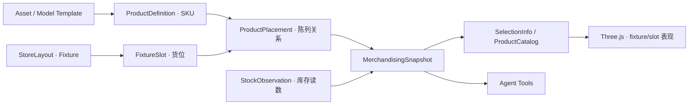

# SPEC v3.1 — Product-to-Twin：商品—货位—孪生状态—Agent 统一业务链路

> **项目**：YH-TwinOps（永辉风格大型门店全店运营数字孪生，教学模拟）\
> **目标仓库**：[`Zhanghoks/YH-TwinOps`](https://github.com/Zhanghoks/YH-TwinOps)\
> **核实基线**：`main` @ `e3313264c186015cac87ab32b6094719b38bd143`（2026-11-20，检查时 HEAD 与该 SHA 一致）\
> **建议开发分支**：`feat/yh-product-placement-domain`\
> **拟定交付路径**：`docs/yh-course/spec-product-to-twin-v3.1.md`\
> **状态**：Proposed / Implementation-ready after repository verification；**不是已实现功能**\
> **优先级**：P0 课程 Agent MVP 能力补全\
> **技术边界**：只使用合成数据；不接入永辉真实 POS / ERP / 顾客身份数据；不执行真实采购或库存扣减。\
> **许可证**：遵守当前仓库 AGPL-3.0-only，保留上游与独立新增代码署名及第三方 notices。

---

## 0. 决策摘要（必须先读）

下一轮**不要继续新增独立 3D 货架演示、零散商品模型或装饰性 UI**。在现有 `@yh/*` 数据/Agent 框架及精细门店画面之上，打通以下真实调用链：

**商品目录中的 SKU → 合法货架格位 Slot → 可逆陈列 Placement → 带来源/时效的 SKU 库存观测 → 3D 选中对象和详情 → Agent 受限工具查询 → 缺失数据诚实回答。**

第一条完整演示故事：

1. 店长打开约 `130×100m` 的密集概念门店，选中 **F077 包装食品货架**；
2. 查看货架原有试点陈列位置，选择其中一个合法、真实存在的格位；
3. 在「商品目录」中从现有模型模板登记一个新示意 SKU，选择该格位，预览与原商品的差异；
4. 验证成功后，仅在**教学沙盒**内应用这一格位的 SKU 替换；3D 货架、商品目录的关联、设施详情同时更新；
5. 询问 Agent：“F077 放了什么商品？`YH-LOCAL-001` 还有多少库存？”Agent 调用工具报告陈列事实；若没有可靠库存观测则回答 **UNKNOWN**；
6. （验证入口）注入明确标注 `synthetic: true` 的库存观测，Agent 与设施详情在同一情景快照下读到相同值；
7. 撤回本次沙盒变更，原始 596 个试点陈列映射不受影响。

**本阶段只打通一个代表设施 F077 的可编辑闭环**，保留 F029 / F050 / F074 / F107 的既有只读试点映射。面向其他设施的通用化属于后续 Sprint。

## 1. 当前源码基线（已核实的事实）

| 已有实现                                                    | 真实位置                                                           | 本次沿用方式                                  |
| ------------------------------------------------------- | -------------------------------------------------------------- | --------------------------------------- |
| `StoreLayout`、`Fixture`、`TwinSignal`、四级观测分级及 Zod 校验 | `packages/contracts/src/index.ts`                              | **扩展**陈列契约，不破坏现有信号和快照结构                 |
| 门店投影、分区/设施 KPI 与证据、UNKNOWN/stale                        | `packages/twin-state/src/index.ts`                             | 不把 SKU 的库存混入共享 `stock_level` 键；另建商品维度投影 |
| 9 个门店证据/仿真工具及规则模式/可选 pi-ai                              | `packages/agent/src/{tools,rules,pi-adapter}.ts`               | 新增两个只读工具，复用原证据格式和服务器 LLM 约束             |
| `/api/agent/ask`、`/api/approvals` 沙盒                  | `apps/api/src/{agent,main,approvals}.ts`                       | 对请求契约做**可选、向后兼容**扩展，不新增生产写操作            |
| 16 个稳定示意 SKU、模型模板注册、本地新增最多 32 条                         | `apps/web/src/catalog/productCatalog.ts`                       | 保留 v1 本地格式、模板机制、数据合法性校验                 |
| 五个试点、596 个确定性陈列映射                                       | `apps/web/src/catalog/productPlacements.ts`                    | 仅作为**只读基线**，不声称真实 SKU/库存                |
| F077 同款填充的可逆预览、层/湾/面位置规则                                | `apps/web/src/scene/sameSkuFill.ts` 等                          | 复用货架挂点/碰撞逻辑，避免两个填充系统叠加                  |
| 独立 3D 商品渲染和 SVG 模型预览                                    | `detailedProductThree.ts`、`ProductModelPreview\.tsx`         | 使用现成模板，不复制新的 renderer                   |
| 3D 选中设施查看元数据                                            | `apps/web/src/ui/SelectionInfo.tsx`                            | 增加 SKU/货位/库存读数；修复其硬编码导入基线布局的风险          |
| 大型密集场景、局部可逆资产试换、商品页                                     | `apps/web/src/{App,scene/DetailedStore,ui/ProductCatalog}.tsx` | 保持当前精细模式、镜头、图层、局部试换行为不回归                |
| 模拟实时工作时钟与业务数据                                           | `apps/web/src/{operatingClock,operatingModel}.ts`              | **不把随钟合成销售推断为 SKU 真实交易**                |

重要源码限制：`apps/api/src/agent.ts` 当前请求是 `{question, at, layout, signals}`；Agent 目前没有 SKU/格位专用工具；`SelectionInfo` 当前从 `../data` 读基线 `layout`，而 App 可在密集 `planningResult.layout` 与旧基线间切换；这个空间版本一致性缺口需在此 PR 修正。

现有 `buildProductPlacements()` 的 `sourceSlotId`、`mountId` 是**试点模型实际挂点**，不要自创业务上不存在的槽位 ID。`PRODUCT_MODEL_REGISTRY` 属于客户端模型模板，不可等同企业主数据。

## 2. 要解决的业务问题

店长虽能在 3D 中看到货架，但现在还不能从统一的上下文可靠查询：该货架**具体陈列了哪些 SKU、在哪一格、商品资料来源、是否有对应库存观测、数据过期与否**。缺少这些语义，后续 Agent 只能回答宏观分区 KPI，无法在“全店情境”中定位商品级运营问题。

**本 PR 的结果是建立可用的商品语义和可信度基础，不是直接优化补货算法。**

### P0 成功指标

- 一个源于现有货架工厂的 `F077/sourceSlotId` 可映射到唯一有效 `SKU`，并能反向查找；
- 同一有效陈列映射在目录、3D 选择详情与 Agent 工具返回中一致；
- 未采集库存 = `UNKNOWN`，不能通过陈列数量、商品模型个数、`capacity` 或合成销量猜算库存；
- 用户在同一浏览器完成沙盒预览/保存/撤回（如采用持久化，则明确浏览器范围）；
- 不影响原收银拥堵仿真、审批沙盒和既有 3D 局部替换试验。

### 明确不做（非目标）

- 不做可自由上传任意 GLB、真实商品条码库、跨用户 ERP 级主数据管理；
- 不做真实销售扣减、采购订单执行、实时库存同步、商品售价/毛利模型；
- 不对全店 205 个关键设施批量安装新柜；不全门店 400–800 设施自由摆货；
- 不把每一个画面商品 Mesh 都当作独立库存单位；
- 不增加第二个 WebGL `<Canvas>`；不将旧 4,000㎡ 场景当正式默认场景；
- 不在本 PR 归档 StoreX/StoreX-Chain（另一个独立迁移议题）；不修改上游 Storewright 非 YH 功能。

## 3. 领域划分与身份契约

不要把 Product（SKU 定义）、ProductModel（3D 模板）、Slot（物理挂点）、Placement（SKU 陈列关系）、Stock（库存观测）、Signal（经营事件）混成一张表。

````

````

### 3.1 统一 ID 与术语

| ID/字段                | 语义          | 唯一性与规则                                         |
| -------------------- | ----------- | ---------------------------------------------- |
| `storeId`            | 教学门店        | 继承现有 `StoreLayout.storeId`                     |
| `zoneId`             | 分区          | 继承 `StoreLayout.zones`                         |
| `fixtureId`          | 货架/柜台/设备组   | 继承 `StoreLayout.fixtures`，例如 `F077`            |
| `slotId`             | 一格真实模型挂点    | 精确采用现有 `sourceSlotId`，不依赖 Three.js 对象索引        |
| `placementId`        | 单格 SKU 陈列关系 | 建议稳定编码 `${fixtureId}/${slotId}`，不得用数组序号        |
| `sku`                | 商品目录中的单品标识  | 复用 `YH-DEMO-*` 或合法本地新增 SKU                     |
| `modelKey`           | 3D 几何模板     | 仍由 `ProductCatalogItem.modelKey` 给出，不代表 SKU 身份 |
| `stockObservationId` | 一次库存读数      | 唯一不可复用；记录来源、时间、synthetic 与分级                   |

### 3.2 新增共享类型（建议 API 形状）

在 `packages/contracts/src/merchandising.ts` 中用 Zod 定义并从 `index.ts` 导出；下面仅为目标形状，具体字段校验参见下一节。

```
export interface ProductDefinition {
  sku: string;
  name: string;
  category: string;
  temperatureZone: '常温' | '冷藏' | '冷冻';
  modelKey: string; // 已有模板键，服务端不执行几何
  referenceSizeMm: readonly [number, number, number];
  synthetic: true;
}

export interface FixtureSlot {
  fixtureId: string;
  slotId: string;
  moduleIndex: number;
  mountId: string;
  // 物理约束和位姿从既有货架工厂取得，不由前端任意构造
}

export interface ProductPlacement {
  placementId: string;
  storeId: string;
  fixtureId: string;
  slotId: string;
  sku: string;
  origin: 'SEED' | 'USER_SANDBOX';
  synthetic: true;
}

export interface SkuStockObservation {
  id: string;
  storeId: string;
  zoneId: string;
  fixtureId: string;
  sku: string;
  quantity: number | null;
  unit: '件';
  kind: 'OBSERVED' | 'ESTIMATED' | 'SIMULATED' | 'UNKNOWN';
  synthetic: true;
  sourceId: string;
  observedAt: string;
  ingestedAt: string;
  validUntil?: string;
  confidence?: number;
  scenarioId?: string;
  modelVersion?: string;
}

export interface SkuInventoryReading {
  sku: string;
  fixtureId: string;
  onHand: number | null;
  unit: '件';
  kind: 'OBSERVED' | 'ESTIMATED' | 'SIMULATED' | 'UNKNOWN';
  stale: boolean;
  sourceId: string | null;
  observedAt: string | null;
  evidenceIds: string[];
  synthetic: true;
}
```

**注意：** `onHand` 是独立库存观测的数量，**不是**物理陈列模型个数、`facingCount`、货架容量或试换对象数。首版 `ProductPlacement` 不含库存数量，也不需要在 `TwinSignal` 中新增 `sku` 字段，避免原有按 `metric` 聚合的分区/设施读数发生串 SKU 覆盖。

### 3.3 数据验证与拒绝准则

- SKU、fixture、slot 都存在；`fixture.zoneId` 与对应观测 `zoneId` 一致；
- 一个 `fixtureId + slotId` 只有一个生效 SKU；同一 SKU 可出现在多个 slot；
- 陈列对象的 `slotId` 必须来自确定性挂点枚举，不能允许用户传任意坐标；
- `referenceSizeMm` 有限且为正，优先利用原尺寸做几何净空验证，超高/超深则拒绝并保持原商品；
- 品类与温区必须匹配门店设施约束（示例：常温货架不得接受强制冷冻 SKU）；
- `UNKNOWN` 时 `quantity` 必须为 `null`；其他类型必须为非负有限数；`SIMULATED` 必带 `scenarioId + modelVersion`；`ESTIMATED` 带 `confidence`；
- 读数不得晚于查询时间；同 key 乱序输入按 `observedAt` 最新，时间相同再按 `ingestedAt` 决定；按 `id` 幂等去重；
- 过期观测只能出现在解释/溯源中，不参与数值决策；输出 `UNKNOWN / stale=true / onHand=null`，可附最后已知值但绝不能当当前库存；
- **所有 P0 商品、陈列、库存数据都标 `synthetic: true`**，即使在模拟源内标 `OBSERVED`，也必须显示“合成观测”。

## 4. 共享逻辑包与不破坏既有 TwinState 的方案

新增一个**纯逻辑**的工作空间包：

```
packages/merchandising/
├── package.json
└── src/
    ├── index.ts               # 查询与组合视图导出
    ├── validate.ts            # 关联、温区、容量、来源检查
    ├── inventory.ts           # 单 SKU 库存观测投影与 stale/UNKNOWN
    ├── placementOverlay.ts    # baseline + browser sandbox overlay
    └── merchandising.test.ts  # 纯函数与属性测试
```

`packages/contracts` 放通用 Zod DTO；`packages/merchandising` 放校验、关联、投影，不导入 `apps/web`、`Three.js` 或 `@yh/agent`。

```
function projectMerchandisingState(input: {
  at: string;
  layout: StoreLayout;
  products: readonly ProductDefinition[];
  baselinePlacements: readonly ProductPlacement[];
  placementOverrides?: readonly ProductPlacement[];
  stockObservations?: readonly SkuStockObservation[];
  validSlotIdsByFixture: Readonly<Record<string, readonly string[]>>;
}): MerchandisingSnapshot;
```

**投影结果**应可按 fixture 查询产品和货位、按 SKU 查询所有陈列位置及库存，并返回版本/来源/不确定性信息。严禁在 `projectTwinState` 内通过 `stock_level` 覆盖单 SKU 数据；原 `TwinSnapshot`、收银仿真和告警处理语义保持不变。

建议上下文：

```
interface StoreAgentContext {
  twin: TwinSnapshot;
  merchandise?: MerchandisingSnapshot;
}
```

原 Agent 没有 `merchandise` 时照常工作，新工具返回明确的 `UNKNOWN / merchandise-unavailable`。

## 5. 现有五个试点映射的适配

在 `apps/web/src/catalog/` 新增 `merchandisingAdapter.ts`：

1. `PRODUCT_CATALOG_SEED` + 用户本地 catalog → `ProductDefinition[]`；
2. `buildProductPlacements()` 的 596 个已有基线 `sourceSlotId` → 带 `storeId` 的 `ProductPlacement[]`；
3. 从已有 `buildShelfGroupReplacement()` 等工厂构建 `FixtureSlot[]`，**不复制/推断**挂点坐标；
4. 与 `StoreLayout` 当前激活版本匹配（130×100 密集场景）。若用户切换回 80×50 基线、或目标 F077 尺寸/方向不满足匹配条件，进入只读/不可应用状态，不能静默把密集版挂点贴上旧版货架；
5. 对 F029 / F050 / F074 / F107 仅显示原试点映射，不开放编辑；F077 支持单格可逆试摆；
6. `16` 个基础商品、`32` 个允许的本地新增上限、已有 catalog localStorage v1 均不变；新增放置覆盖用**独立 key**并做显式版本化。

建议本地 key：`yh-twinops:placement-overrides:v1`。保存时只序列化白名单 DTO；不要持久化 Three.js 组件、几何对象或模拟库存。无论读取成功/失败都给用户明确状态；不合法数据回退到 seed，不得静默部分覆盖。

### 5.1 F077 与当前「同款填充」的优先级

当前 F077 已有 `sameSkuFill` 临时填充，不能再无条件叠加新目录陈列造成重复商品。实现单一来源的互斥规则：

- 当 `sameSkuFill` 正在展示时，新商品的格位应用按钮不可用，显示“请先撤回同款填充”；
- 若新格位覆盖已应用，原同款填充功能可以先提示撤回覆盖再运行；
- 不允许同时激活两个彼此不知情的 overlay；
- 只替换指定 `slotId` 的 SKU / render model，不生成新的格位，不改变其他 slot、fixture 或顾客路线。

## 6. 前端交互与 3D 场景联动（P0）

### 6.1 「商品目录」新增一个明确的陈列动作

在现有 `ProductCatalog` 商品详情中增加“试摆到货位”入口（只对 F077 可用）。选择商品后可进入：

- 目标设施 `F077`（密集版、已核验）；
- 格位选择器：显示合法 `module / side / bay / level` 及当前 SKU；
- 试摆预览：原商品与目标 SKU、原尺寸/新尺寸、温区一致性、格位净空结果；
- 操作按钮：“预览试摆” → “应用到本机模拟场景” → “撤回”；
- 明确文字：“商品陈列示意，不代表库存，也不会更改销售数据”。

`新增商品` 仍沿用现有模板继承方式，不扩展 GLB 上传。新增 SKU 不自动获得货位；必须明确选格、验证、保存。

### 6.2 「3D 数字孪生」只改一个格位

在 `DetailedStore` 和现有 F077 组件替换/商品模型生成处，将单格实际 placement 变化驱动到真实可见的模型。具体应调用既有 `buildShelfGroupReplacement` 的挂点数据与 `makeDetailedProduct` 模板实例化，不可通过 `scene.children[index]`、DOM 文案或颜色硬编码来决定业务身份。

- 空货架模型仍为空结构，与 SKU 商品几何分离；
- 选择 F077 时展示已应用到模拟场景的 SKU 与 slotId；
- 预览不污染原始 596 映射；
- 切换相机、LOD、精细/白膜（不支持的模式需说明）、商品目录、经营看板后数据一致；
- 不破坏已存在的 F032/F029/F050/F074/F107/F120 局部试换与回退功能。

### 6.3 修正 Selected Fixture 读取的布局版本

当前 `apps/web/src/ui/SelectionInfo.tsx` 导入 `../data` 中的基线布局，而主 App 会生成密集版 `planningResult.layout`。本次修改应从上层传入**当前激活的 `layout` 与 MerchandisingSnapshot**，不允许另读静态基线；在 80×50、130×100 场景切换后，显示的坐标、设施与 SKU 必须属于同一版本。

展示区示例：

```
设施 F077 · 包装食品双面货架
位置：zone-packaged · 密集概念版（合成）
陈列：已知 16 个格位中 ...（此处仅示意，不硬编码数量）
当前选中的格位：module-0 / side +1 / bay-2 / level-1
SKU：YH-LOCAL-001 · 示意薯片
库存：无可靠观测（UNKNOWN）
数据：陈列=本机模拟配置；库存=未提供，不代表 0 件
```

数据真正存在时显示 `onHand`、时间戳、来源和 `synthetic`，必要时显示 stale/过期。

## 7. Agent 工具与 API 扩展

### 7.1 新增两个只读工具

给 `packages/agent/src/tools.ts` 的 `AgentTools` 增加：

```
get_fixture_products(args: { fixtureId: string }): AgentToolResult;
get_sku_inventory(args: { sku: string; fixtureId?: string }): AgentToolResult;
```

工具契约要求：

- `get_fixture_products` 返回该设施内已映射的 SKU、产品名、位置 `slotId`、来源 `SEED/USER_SANDBOX`、编辑状态；无映射返回已知空列表或 UNKNOWN（区分“已核验但无陈列”和“未覆盖”），不能编造；
- `get_sku_inventory` 未提供 SKU 级观测时返回 `UNKNOWN`，包含 `reason` 与所需数据源；多设施同 SKU 不能把不同位置的数量混成一个现有 `stock_level`；
- 若有效观测存在，应带 `observation id`、`sourceId`、`observedAt`、`synthetic`、`kind`、单位与数据时效；
- 读取货位/商品关系不产生任何写入，不自动转为入库、补货或销售事件；
- 当前已有的 9 个工具、证据追溯与 `UNKNOWN` 语义无回归。

**不新增 Agent 写工具。** 格位应用与撤回必须是用户在 UI 上显式动作；可选的店长审批流程属于后续阶段，不复用现有收银调班审批冒充商品调整审批。

### 7.2 规则 Agent 与 pi-ai 适配

- 在 `packages/agent/src/rules.ts` 增加明确的商品/货架类问句，如“F077 上有什么？”、“YH-LOCAL-001 库存多少？”；优先调用新工具，不凭预设词语估算数值；
- 在 `packages/agent/src/pi-adapter.ts` 的工具 JSON Schema、tool registry、system guidance 中白名单注册两工具，继续维持服务端调用和迭代上限；
- 返回结构保持现有 `AgentToolResult { status, data, evidence }` 和回答带工具轨迹模式；
- 未配置模型 / API 故障时本地规则降级仍可回答**同一份**商品上下文，而不是本地回答陈列 A、服务端回答陈列 B。

### 7.3 API 请求新增可选业务上下文

`apps/api/src/agent.ts` 原请求 `{question, at, layout, signals}` 保持兼容，增加可选 `merchandising`（或同义更简洁命名）：

```
interface AgentAskBodyV31 {
  question: string;
  at: string;
  layout: unknown;
  signals: unknown[];
  merchandising?: {
    products: unknown[];
    placements: unknown[];
    validSlotIdsByFixture?: Record<string, string[]>;
    stockObservations?: unknown[];
    contextVersion?: number;
  };
}
```

服务端必须对嵌套数组进行数量、字符串长度、字段白名单、SKU/fixture/slot 关联及 `synthetic: true` 验证，不能裸 `as` 强转；拒绝超预算请求并给清楚 4xx。为本阶段防止滥用，建议上限：`products ≤64`、`placements ≤1000`、`stockObservations ≤1000`，具体按合成实际测试确认。**不信任浏览器送来的任何库存是企业事实。**

API 收到 merchandising 时先做 Zod 验证、投影 `MerchandisingSnapshot`，再将其作为 `createAgentTools` 可选依赖；没有时商品类问题给出 UNKNOWN，原收银类问题仍正常。`/api/approvals` 不改。

### 7.4 合成库存观测入口（仅测试 / 教学沙盒）

最小实现可通过预置测试数据或受限的开发情景按钮注入一条 `SkuStockObservation`。强调：

- 不从 3D 数量、示意销售预测或商品目录反推库存；
- 模拟 `OBSERVED` 也必须同时显示 `synthetic: true` 与来源 `synthetic-stock-fixture`；
- 应用观测应更新 `MerchandisingSnapshot`，而不改 `ProductPlacement`；
- 时间推进或观测过期后降为 UNKNOWN，证据可追溯；
- 不引入通用 POS 交易事件总线，本功能属于后续事件接入 Sprint。

## 8. 数据流与依赖边界

````
```mermaid
flowchart TB
 A[现有 ProductCatalog v1] --> B[Web Adapter]
 C[现有 596 seed placements] --> B
 D[当前 StoreLayout / 合法挂点] --> B
 E[本机可逆 placement override] --> B
 B --> F[@yh/merchandising · pure projection]
 G[合成库存观测或 UNKNOWN] --> F
 F --> H[SelectionInfo]
 F --> I[F077 3D asset rendering]
 F --> J[@yh/agent · 新只读工具]
 J --> K[本地规则 Agent]
 J --> L[服务端 pi-ai Agent]
 L --> M[工具轨迹和证据]
 K --> M
```
````

依赖只能从业务域到应用层单向流动：

- `packages/contracts`：Zod types，无 Three.js；
- `packages/merchandising`：纯函数，无 DOM、浏览器 storage、渲染器；
- `apps/web/src/catalog/merchandisingAdapter.ts`：将现有 Web-only model types 转换为共享 DTO；
- `apps/web` 负责 UI、3D、存储及用户显式操作；
- `packages/agent` 只读取投影和执行白名单工具；
- `apps/api` 负责重新验证用户发来的上下文，调用同一套纯逻辑。

避免为了一次试点把浏览器模型注册文件搬进 server 或在 Agent 工具中 import Three.js；不得硬编码第 596 个位置或把货位号视为面向全店永久业务数据。

## 9. 文件级工作清单（供 Codex 执行）

### Task 0 · 基线与原行为冻结

- `git status --short` 确保识别用户已有未提交改动，不覆盖；
- 记录 `git rev-parse HEAD`，确认计划以 `e3313264...` 为基线；若 HEAD 变化，先对比差异更新具体受影响文件；
- 先阅读 `AGENTS.md`、`docs/yh-course/product-catalog.md`、`docs/yh-course/same-sku-fill.md` 和既有试换安全复核；
- 在新分支实现，禁止直接强推 main。

### Task 1 · DTO 与纯函数（先测试）

- 新增 `packages/contracts/src/merchandising.ts`，从 `index.ts` 导出；
- 新增 `packages/merchandising/` 包、校验与状态投影；
- 不改 `TwinSignal` 聚合语义，确保原 snapshot 代码输出不变；
- 编写 SKU/slot 关联、库存 UNKNOWN/stale、幂等和乱序测试。

### Task 2 · Web Adapter 与沙盒覆盖

- 新增 `apps/web/src/catalog/merchandisingAdapter.ts`；
- 复用 `buildProductPlacements()`、`seedSkuIdForKind()`、`buildShelfGroupReplacement()` 的实际 ID；
- 新增独立版本化 placement storage，预览/应用/撤回；
- 对非法 slot、温区不兼容、尺寸超限、旧基线模式和 F077 同款填充冲突做安全拒绝。

### Task 3 · 3D 及工作台最小联动

- 增强 `apps/web/src/ui/ProductCatalog.tsx` 和 F077 局部预览控件；
- `DetailedStore` 中只针对 F077 的真实 mount 渲染新增 SKU 的合法模板模型；
- `SelectionInfo` 改从 `App` 接受**当前 layout 和 merchandising snapshot**，不再固定读 `../data`；
- 保留商品页的 SVGRenderer，不引入第二 WebGL 画布；
- 变更不影响运营 KPI、F029/F050/F074/F107 和既有收银仿真。

### Task 4 · Agent + API

- `packages/agent/src/tools.ts` 新增两个只读工具，并有独立测试；
- `rules.ts` / `pi-adapter.ts` 注册工具及问句路由，证据引用正确；
- `apps/api/src/agent.ts` 扩展可选请求，完整重新校验；
- `apps/web/src/api.ts` 仅发送经过投影验证的紧凑上下文；
- 未配置 LLM / 后端不可达时保持离线可演示。

### Task 5 · 端到端演示、文档与验证

- Web 组件测试：新增商品→合法 slot→预览→应用→可撤回；
- Agent 测试：陈列证据、无库存 UNKNOWN、注入合成库存后更新、stale；
- E2E 在实际浏览器覆盖 F077 点选→录入→试摆→商品/Agent 一致→撤回；
- 保留旧 F077 同款填充测试；
- 文档新增 provenance、数据模型、边界及非生产免责声明；记录本次完整验证命令与实际结果。

## 10. 验收用例（必须可自动化）

| ID    | 前置条件与动作                               | 预期                                            |
| ----- | ------------------------------------- | --------------------------------------------- |
| AT-01 | 原 16 SKU + 596 试点映射加载                 | 数量与 SKU 稳定；没有新增库存                             |
| AT-02 | 本地录入 `YH-LOCAL-001`                   | 可以浏览、预览模型，但没有自动上架或库存                          |
| AT-03 | F077 选择一个真实存在的 sourceSlotId 试摆        | 有合法位置与尺寸时仅该格发生 SKU 变化，`fixtureId/slotId` 不变 |
| AT-04 | 填入不存在的 slotId、越界尺寸、错误温区               | 拒绝并提示原因；无部分写入、无原商品丢失                          |
| AT-05 | F077 正在运行 sameSkuFill                 | 禁止叠加新置换或明确先撤回；不出现双重渲染                         |
| AT-06 | 3D 与商品目录切换后选中 F077                    | SKU、slotId、fixtureId、场景版本一致                   |
| AT-07 | 在 130×100 密集场景与 80×50 基线之间切换          | 不把密集版陈列套进基线；无悬挂引用                             |
| AT-08 | Agent 问“F077 有什么商品？”                  | 工具返回确定性真实映射和来源；回答带工具证据                        |
| AT-09 | Agent 问某 SKU 的库存、无库存观测                | `UNKNOWN`，不以陈列模型数、销售推算出库存                     |
| AT-10 | 注入 1 条 `synthetic: true` 的有效 SKU 库存观测 | 对应 SKU 和设施更新，其他 SKU/设施不变化                     |
| AT-11 | 时间推进造成库存观测 stale，或输入乱序/重复数据           | stale 值不再可决策；时间和证据完整；幂等                       |
| AT-12 | 不配置 LLM、断开 API                        | 浏览器规则工具仍正确回答陈列/库存数据，且标记离线模式                   |
| AT-13 | 服务端缺少 merchandising 上下文               | 原 Agent 接口保持兼容；商品问题返回 UNKNOWN                 |
| AT-14 | 用户应用并撤回一次试摆                           | 基线 596 映射恢复；既有 F077/SKU fill 开关不被破坏           |
| AT-15 | 提交恶意 browser payload/过大数组/伪造对象        | Zod/边界校验拒绝；不允许任意坐标/任意上传脚本或真实写入                |
| AT-16 | 原有收银仿真、审批和三视图测试                       | 与基线输出兼容；无新的 Canvas、无 3D 场景重置问题                |

**验收注记**：AT-10 只能声称“合成库存观测已投影”；不能写成“实时对接永辉库存”。若浏览器真实 WebGL 未运行，必须写明未验证，不能拿纯组件测试代替视觉验收。

## 11. 工程质量门槛

从仓库根目录执行（按当前 package scripts）：

```
npm install
npm run typecheck
npm run check
npm run build -w @yh/web
npm test -w @yh/web
npx playwright test -c playwright.yh.config.ts
```

- 若仓库有已知外部环境失败，报告**确切失败测试名、堆栈、对本 PR 的影响**，不合并为“所有测试通过”；
- 新增 `packages/merchandising` 的测试应被根 `vitest.config.ts` 的 `packages/*/src/**/*.test.ts` 自动拾取；
- 原 `packages/agent`、`packages/contracts`、`packages/twin-state` 与 F077 同款填充测试必须不回归；
- 产品页切换、Agent 问答与 3D 场景都保持单次 React 树状态，不能因为进入「商品目录」就丢失已确认的沙盒 placement；
- 真实浏览器验证需查看无穿模、合法货位视觉、模型尺寸、相机/LOD 与 GPU 表现；报告至少 2 张截图（一张试摆前、一张试摆后）并注明是否真实运行；
- 不引入新状态管理框架、新 WebGL 引擎、新托管服务；只在确实必要时安装依赖。

## 12. 版本、回退、安全和 provenance

- baseline 596 映射只读并保留原 hash/版本；用户沙盒覆盖有独立 `version = 1` 的存储格式；
- 从 `localStorage` 读取失败或数据版本不兼容，安全回退为 baseline，并在 UI 显示“本地陈列数据不兼容，已退回原版”；
- “应用到模拟场景”不是店长生产审批，也不做 ERP 写入；不更改已有 `apps/api/src/approvals.ts` 收银审批意义；
- 除当前显示字段外不需要个人顾客身份；数据示例全部匿名合成；
- 若 API 远程运行，`merchandising` 请求来自客户端，只在教学沙盒内解释，不允许其来源标签伪装成企业认证数据；
- 不得使用原始产品名称/贴图/品牌 Logo 制作未经授权的商品模型；保留上游 Storewright 和 Beautiful UI 的许可声明。

## 13. 与课程评分标准对应

| 课程评分项              | 本 PR 可作为直接证据的交付                                            |
| ------------------ | ---------------------------------------------------------- |
| 场景调研（15）           | 真实门店 SKU/货架数据为什么难统一；区别真实证据、行业假设与合成参数                       |
| EA + Agent MVP（30） | 数据架构中的 `SKU—Slot—Fixture—Zone` 关系、应用架构的商品目录→孪生→Agent、可操作演示 |
| 数字化落地（35）          | SKU 主数据治理、数据时效/覆盖、库存接入适配器与权限治理的可行性路径                       |
| 成果展示（20）           | 点击货架→新增/试摆商品→查询库存与来源→发现 UNKNOWN→注入合成观测→Agent 证据更新          |

这是为课程作品建立的**可信数据闭环原型**。项目研究主痛点仍是“店长对全店状态缺乏统一可观测性，决策缺少可靠上下文”，不是重回纯货架布局优化课题。

## 14. 明确的开发完成定义（Definition of Done）

1. AT-01 至 AT-16 可用实际代码、测试或人工浏览器审查逐条证明，失败项如实列出；
2. 16 个种子商品、原 596 映射、F077 同款填充和收银高峰仿真无回归；
3. F077 的**一个合法格位**可以从商品目录编辑到 3D 展示并撤回；
4. `get_fixture_products` / `get_sku_inventory` 的输出和 Agent 回答均可追溯，不伪造库存；
5. 浏览器本地模式与服务端 Agent 模式对同一快照和上下文返回一致的事实；
6. 新代码不依赖 Storewright 原有其他作品的 UI；
7. 产出代码变更、实际测试日志、前后截图、已知限制和 AGPL/第三方许可更新说明；
8. 只在新功能已验证后提交 PR；未经用户指示不强推 main、不自动合并。

---

## 15. 给 Codex / Cursor 的执行说明（可直接复制）

> 在 `Zhanghoks/YH-TwinOps` 仓库中执行 `docs/yh-course/spec-product-to-twin-v3.1.md`。以 `e3313264c186015cac87ab32b6094719b38bd143` 为审计基线；如果 HEAD 更新先对比差异。目标只有一个：打通 ProductCatalog→F077 已核验 Slot→可逆 Placement→独立 SKU 库存读数→SelectionInfo/3D→Agent 两个只读工具。请先阅读 `AGENTS.md`、现有 catalog/placement/sameSkuFill 与 contracts/twin-state/agent 源码，列出分文件实施清单、数据契约和回归测试，然后按纯函数测试→Web adapter→场景/目录联动→Agent/API→E2E 的顺序实现。未经校验不得改布局基线、不得把商品模型个数当库存、不得新增第二个 WebGL Canvas、不得绕过当前 596 试点映射、不得把合成读数叫真实数据。完成时汇报修改文件、验收用例、实际通过/失败测试、截图证据与未完成项，提交 PR 等待 review。不要改 StoreX 或非 YH 业务模块。

### 下一轮（不包含在当前 PR）

- **v3.2**：把真实形态的合成 POS SaleEvent、库存 StockEvent、区域客流等接入统一时序 Event Adapter，并建立可回放的 SKU 状态；
- **v3.3**：让 Agent 基于 SKU、货位、库存、销量和数据盲区完成更复杂的运营诊断与模拟；
- **v3.4**：按已审查的尺寸与业务语义，从代表点逐批推广全店高保真资产，并做 WebGL 性能回归；
- **v3.5**：将建议→仿真→人工审批→模拟执行→事件回流做成统一的全店业务闭环。
